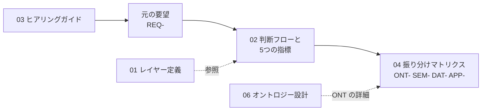

# AI-Ready Requirements

[English](README.md) | **日本語**

要件定義の段階で、**それぞれの要件をどのレイヤーに置くか**（オントロジー層、セマンティック層、データ層、アプリ / AI 層）を決めるためのフレームワークです。すべての文書を英語（`framework/en/`）と日本語（`framework/ja/`）で用意しており、構成と ID は共通です。

## なぜ必要か

AI によって実装の工数は減りますが、要件定義の工数は減りません。割合で見ると、要件定義の比重はむしろ大きくなります。業務をより深く聞き取る必要があり、さらに「その意味をどこに置くか」を決める必要があるからです。業務ルールがプロンプトに書かれたり、指標がダッシュボードの中で定義されたりすると、画面やエージェントを作るたびに定義のコピーが増え、答えが食い違い始めます。

このフレームワークは、置き場所を決める基準をあらかじめ決めておくことで、ヒアリング、振り分け、その理由の記録をどのプロジェクトでも同じ型で進められるようにします。名前の「AI-Ready」は、ルールや定義が1か所にまとまり、人と AI の両方がそこを参照できる状態を指しています。

## 4つのレイヤー

| レイヤー | 答える問い | 例 |
|---|---|---|
| オントロジー層 | それは何か | 顧客、契約、状態遷移、業務ルール、用語の正式な意味 |
| セマンティック層 | どう数えるか | 指標の計算式、集計軸、粒度、期間の定義、閲覧権限 |
| データ層 | どこから・どれだけ新しく・どれだけ正しく | ソース、取り込み頻度、品質ルール、保持期間 |
| アプリ / AI 層 | 誰に・どう見せるか | 画面、通知、操作フロー、プロンプト、エージェントの振る舞い |

### オントロジー層の中身

オントロジー層は AI が最初に読む層なので、さらに5つの要素に分け、**語彙 → 構造 → 状態と事象 → ルール → アクション**の順に参照します。後ろの要素は前の要素だけを参照して書き、要素ごとに必須項目（状態には時点の定義、アクションには AI への許可（自動 / 人の確認後 / 禁止）など）を持ちます。詳しくは [オントロジー設計ガイド](framework/ja/06_ontology-design.md) を参照してください。

## 5つの指標

置く層がはっきりしないときは、各指標を1〜3点で評価します。合計9点以上なら共有の定義（オントロジー層またはセマンティック層）に、8点以下ならアプリ / AI 層に留めてよい、と判断します。

| 指標 | 1点 | 3点 |
|---|---|---|
| 再利用範囲 | 1つの画面・エージェント | 全社 |
| ブレたときの影響 | 見た目が違う程度 | 金額・契約・法令 |
| 変更頻度 | 週〜月単位 | 年単位以下 |
| 決定権者 | プロダクトチーム | 経営・業務オーナー |
| AI からの参照 | 1つのエージェント | 全社の AI・システム |

## 文書一覧

| # | English | 日本語 | 内容 |
|---|---|---|---|
| 01 | [The four layers](framework/en/01_layers.md) | [4つのレイヤー](framework/ja/01_layers.md) | 各層が持つもの・持たないもの、層の境目を判定する3つのテスト、層間の契約 |
| 02 | [Placement criteria](framework/en/02_decision-criteria.md) | [振り分けの判断基準](framework/ja/02_decision-criteria.md) | 基本原則、判断フロー、5つの指標、よくある置き間違い |
| 03 | [Interview guide](framework/en/03_interview-guide.md) | [ヒアリングガイド](framework/ja/03_interview-guide.md) | 層ごとの質問リストと、ヒアリング中に注意するサイン |
| 04 | [Placement matrix](framework/en/04_placement-matrix.md) | [振り分けマトリクス](framework/ja/04_placement-matrix.md) | 要件ごとに層・点数・理由を記録するテンプレート |
| 05 | [Worked example](framework/en/05_worked-example.md) | [記入例](framework/ja/05_worked-example.md) | 架空のフィットネスチェーンの退会分析。5つの要望を12の要件に振り分けた例と、AI の処理のたどり方 |
| 06 | [Ontology design guide](framework/en/06_ontology-design.md) | [オントロジー設計ガイド](framework/ja/06_ontology-design.md) | オントロジーの5要素と3段の範囲、AI が参照する順番、必須項目 |

## 使い方

1. [ヒアリングガイド](framework/ja/03_interview-guide.md) を使ってヒアリングし、要望を発言者の言葉のまま `REQ-` として書き留めます。
2. [振り分けマトリクス](framework/ja/04_placement-matrix.md) をプロジェクトの `docs/` にコピーします。
3. 要望を層ごとに分割し、[判断フローと指標](framework/ja/02_decision-criteria.md) で1件ずつ振り分けます。
4. すべての振り分けに点数と理由を記録し、マトリクス末尾のチェックリストで確認します。

`REQ-` や各層の ID は、[doc-templates](https://github.com/keito118/doc-templates) の `FR-` などの要件定義書の ID と併用できます。「関連 ID」欄で紐づけてください。

## ライセンス

MIT
