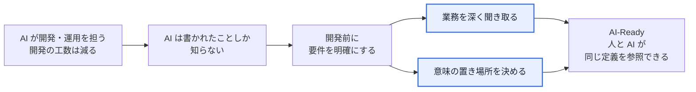

# AI-Ready Requirements

[English](README.md) | **日本語**

要件定義の段階で、**それぞれの要件をどのレイヤーに置くか**（アプリ / AI 層、オントロジー層、セマンティック層、データ層、横断するポリシー）を決めるためのフレームワークです。すべての文書を英語（`framework/en/`）と日本語（`framework/ja/`）で用意しており、構成と ID は共通です。

## なぜ必要か

AI によって自動化が進み、開発の工数は減っていきます。一方で、AI に開発や運用を任せるには、今まで以上に業務を正確に覚えてもらわなければなりません。人は暗黙の前提や文脈で足りない部分を補えますが、AI は書かれていることしか知らないからです。

だからこそ、開発に入る前に要件を明確に定めておく必要があります。業務をより深く聞き取るだけでなく、聞き取った業務の意味を「どこに置くか」まで決めておくことが求められます。開発の工数が減り、要件定義でやることが増えるので、全体に占める要件定義の比率は大きくなっていきます。

置き場所を決めないまま、業務ルールがプロンプトに書かれたり、指標がダッシュボードの中で定義されたりすると、画面やエージェントを作るたびに定義のコピーが増え、答えが食い違い始めます。

このフレームワークは、置き場所を決める基準をあらかじめ決めておくことで、ヒアリング、振り分け、その理由の記録をどのプロジェクトでも同じ型で進められるようにします。名前の「AI-Ready」は、ルールや定義が1か所にまとまり、人と AI の両方がそこを参照できる状態を指しています。

青い2つが要件定義で増える仕事で、このフレームワークはその進め方を定めます。

## 4つのレイヤーと横断ポリシー

層は、AI がプロンプトを処理する順番に並べています。AI は上から順に層を下り、結果を逆向きにたどって回答します。

| 順 | レイヤー | 答える問い | 例 |
|---|---|---|---|
| ① | アプリ / AI 層 | 誰から受け取り、誰に・どう見せるか | 画面、通知、操作フロー、プロンプト、エージェントの振る舞い、ユーザーコンテキストの受け取り |
| ② | オントロジー層 | それは何か | 顧客、契約、状態遷移、業務ルール、用語の正式な意味 |
| ③ | セマンティック層 | どう数えるか | 指標の計算式、1件ごとの値の数え方、集計軸、粒度、期間の定義。データを読むときの唯一の入口 |
| ④ | データ層 | どこから・どれだけ新しく・どれだけ正しく | ソース、取り込み頻度、品質ルール、保持期間 |

**ポリシー**（誰が何を見てよいか・してよいか）は特定の層に置かず、4つの層すべてで適用します。アプリ / AI 層では使えるエージェントやツール、オントロジー層では実行できるアクション、セマンティック層では返してよい範囲、データ層ではマスキングを制御します。操作による書き込みはセマンティック層を通らず、エージェントやアクションの段階で止めるべき依頼もあるため、ポリシーを1つの層だけに置くと抜け道ができます。

### オントロジー層の中身

オントロジー層はプロンプトの意味を確定する層なので、さらに5つの要素に分け、**語彙 → 構造 → 状態と事象 → ルール → アクション**の順に参照します。後ろの要素は前の要素だけを参照して書き、要素ごとに必須項目（状態には時点の定義、アクションには AI への許可（自動 / 人の確認後 / 禁止）など）を持ちます。詳しくは [オントロジー設計ガイド](framework/ja/06_ontology-design.md) を参照してください。

## 5つの指標

置く層がはっきりしないときは、各指標を1〜3点で評価します。合計9点以上なら共有の定義（オントロジー層またはセマンティック層）に、8点以下ならアプリ / AI 層に留めてよい、と判断します。

| 指標 | 1点 | 3点 |
|---|---|---|
| 再利用範囲 | 1つの画面・エージェント | 全社 |
| ブレたときの影響 | 見た目が違う程度 | 金額・契約・法令 |
| 変更頻度 | 週〜月単位 | 年単位以下 |
| 決定権者 | プロダクトチーム | 経営・業務オーナー |
| AI からの参照 | 1つのエージェント | 全社の AI・システム |

## 文書一覧

| # | English | 日本語 | 内容 |
|---|---|---|---|
| 01 | [The four layers and the cross-cutting policy](framework/en/01_layers.md) | [4つのレイヤーと横断ポリシー](framework/ja/01_layers.md) | 各層が持つもの・持たないもの、ポリシーが各層でやること、層の境目を判定するテスト、層間の契約 |
| 02 | [Placement criteria](framework/en/02_decision-criteria.md) | [振り分けの判断基準](framework/ja/02_decision-criteria.md) | 基本原則、判断フロー、5つの指標、よくある置き間違い |
| 03 | [Interview guide](framework/en/03_interview-guide.md) | [ヒアリングガイド](framework/ja/03_interview-guide.md) | 層ごとの質問リストと、ヒアリング中に注意するサイン |
| 04 | [Placement matrix](framework/en/04_placement-matrix.md) | [振り分けマトリクス](framework/ja/04_placement-matrix.md) | 要件ごとに層・点数・理由を記録するテンプレート |
| 05 | [Worked example](framework/en/05_worked-example.md) | [記入例](framework/ja/05_worked-example.md) | 架空のフィットネスチェーンの退会分析。5つの要望を12の要件に振り分けた例と、AI の処理のたどり方 |
| 06 | [Ontology design guide](framework/en/06_ontology-design.md) | [オントロジー設計ガイド](framework/ja/06_ontology-design.md) | オントロジーの5要素と3段の範囲、AI が参照する順番、必須項目 |
| 07 | [How AI processes a prompt](framework/en/07_ai-processing-flow.md) | [AI がプロンプトを処理する流れ](framework/ja/07_ai-processing-flow.md) | プロンプトから回答までの5段階、質問の種類ごとの経路、各段階で守ること、戻り道。図つき HTML 版：[docs/ai-processing-flow.html](docs/ai-processing-flow.html) |

## 使い方

1. [ヒアリングガイド](framework/ja/03_interview-guide.md) を使ってヒアリングし、要望を発言者の言葉のまま `REQ-` として書き留めます。
2. [振り分けマトリクス](framework/ja/04_placement-matrix.md) をプロジェクトの `docs/` にコピーします。
3. 要望を層ごとに分割し、[判断フローと指標](framework/ja/02_decision-criteria.md) で1件ずつ振り分けます。
4. すべての振り分けに点数と理由を記録し、マトリクス末尾のチェックリストで確認します。

`REQ-` や各層の ID は、既存の要件定義書の ID（機能要件の `FR-` など）と併用できます。「関連 ID」欄で紐づけてください。

## ライセンス

MIT
