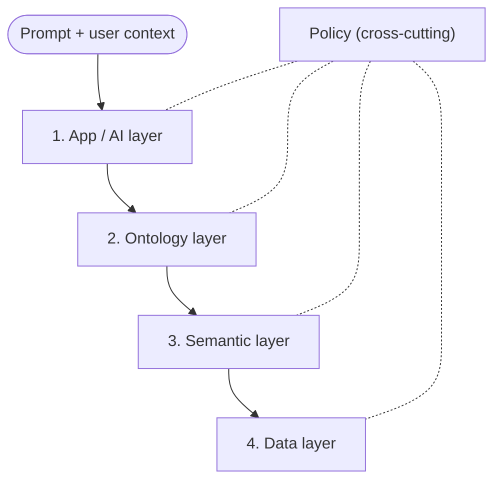
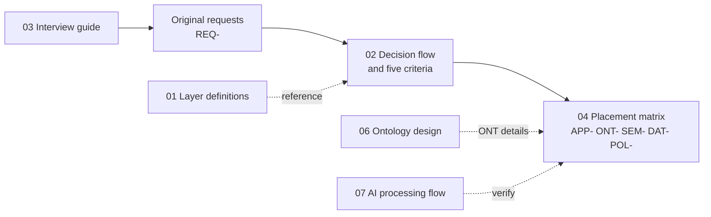

# AI-Ready Requirements

**English** | [日本語](README.ja.md)

A framework for deciding, during requirements definition, **which layer each requirement belongs to**: the app / AI layer, the ontology, the semantic layer, the data layer, or the cross-cutting policy. Every document is available in English (`framework/en/`) and Japanese (`framework/ja/`), with the same structure and IDs in both.

## Why

AI is making implementation cheaper, but it does not make requirements cheaper. As a share of the work, requirements definition grows: you need to understand the business in more depth, and you need to decide where each piece of meaning lives. When a business rule ends up in a prompt, or a metric is defined inside a dashboard, every new screen and every new agent gets its own copy, and the answers start to disagree.

This framework fixes the placement criteria in advance, so that interviews, placement decisions and their reasons follow the same shape on every project. "AI-ready" means that every rule and definition lives in exactly one place that both people and AI can reference.

## The four layers and the cross-cutting policy

The order of the layers is **the order in which AI processes a prompt**. The AI works down the layers, then follows the results back up to answer.

| Order | Layer | Role | Examples |
|---|---|---|---|
| 1 | App / AI | The entrance and the exit: receive, present, behave | Screens, chat UIs, prompts, receiving the user context |
| 2 | Ontology | Meaning: what something is, and what is checked, calculated or done | Objects (member, location, department), logic (is active, calculate churn rate), bindings |
| 3 | Semantic | Calculation: the implementation of logic | Metric aggregations, dimensions, grain, period handling |
| 4 | Data | Values: where from, how fresh, how correct | Sources, ingestion frequency, quality rules, retention |
| Cross-cutting | Policy | Who may see and do what | Access scope, which agents may be used, which operations AI may perform, masking |

Requirements about numbers split into **meaning** (ontology) and **implementation** (semantic). "What churn rate means" goes into ontology logic; its aggregation goes into a semantic-layer view; a binding links them. The AI needs only one entrance, the ontology, and never assembles formulas itself.

### Inside the ontology

The ontology consists of **objects** (concepts with descriptions; departments and brands are concepts too), **logic** (checks, calculations, relations, causes and operations, with objects as inputs and outputs) and **bindings** (which link concepts and logic to tables and semantic views). The user context passes run-time values to objects such as department. See the [ontology design guide](framework/en/06_ontology-design.md).

## The five criteria

When it is unclear whether a requirement about meaning should be a shared definition in the ontology or stay inside one app, score it from 1 to 3 on each criterion. A total of 9 or more means it goes in the ontology; 8 or less means it may stay in the app / AI layer. The score is a guide for aligning the reasons behind a decision.

| Criterion | 1 | 3 |
|---|---|---|
| Reuse scope | One screen or agent | Company-wide |
| Impact of drift | Cosmetic | Money, contracts, compliance |
| Change frequency | Weekly to monthly | Yearly or less |
| Decision owner | Product team | Executives, business owner |
| AI consumption | One agent | Every AI and system |

## Documents

| # | English | Japanese | Contents |
|---|---|---|---|
| 01 | [The four layers and the cross-cutting policy](framework/en/01_layers.md) | [4つのレイヤーと横断ポリシー](framework/ja/01_layers.md) | What each layer owns and does not own, what the policy does in each layer, boundary tests, contracts between layers |
| 02 | [Placement criteria](framework/en/02_decision-criteria.md) | [振り分けの判断基準](framework/ja/02_decision-criteria.md) | Principles, decision flow, five scoring criteria, common misplacements |
| 03 | [Interview guide](framework/en/03_interview-guide.md) | [ヒアリングガイド](framework/ja/03_interview-guide.md) | Questions per layer, and signals to watch for in interviews |
| 04 | [Placement matrix](framework/en/04_placement-matrix.md) | [振り分けマトリクス](framework/ja/04_placement-matrix.md) | Template for recording each requirement, its layer, scores and reason |
| 05 | [Worked example](framework/en/05_worked-example.md) | [記入例](framework/ja/05_worked-example.md) | Membership churn at a fictional fitness chain, and how an AI walks through it |
| 06 | [Ontology design guide](framework/en/06_ontology-design.md) | [オントロジー設計ガイド](framework/ja/06_ontology-design.md) | Objects, logic and bindings, design rules, required fields |
| 07 | [How AI processes a prompt](framework/en/07_ai-processing-flow.md) | [AI がプロンプトを処理する流れ](framework/ja/07_ai-processing-flow.md) | The five steps, routes by kind of question, rules for each step, and the way back. Illustrated HTML version: [docs/ai-processing-flow.html](docs/ai-processing-flow.html) |

## Usage

1. Run interviews with the [interview guide](framework/en/03_interview-guide.md) and write each request down as a `REQ-` in the stakeholder's own words.
2. Copy the [placement matrix](framework/en/04_placement-matrix.md) into your project's `docs/` directory.
3. Split each request by layer, and place each part using the [decision flow and criteria](framework/en/02_decision-criteria.md).
4. Record the scores and the reason for every placement, then go through the checklist at the end of the matrix.
5. Walk a few representative questions through the [AI processing flow](framework/en/07_ai-processing-flow.md) to check for gaps in the definitions.

The `REQ-` and layer IDs can sit alongside a requirements definition such as the `FR-` IDs in [doc-templates](https://github.com/keito118/doc-templates): use the "Related ID" column to link them.

## License

MIT
