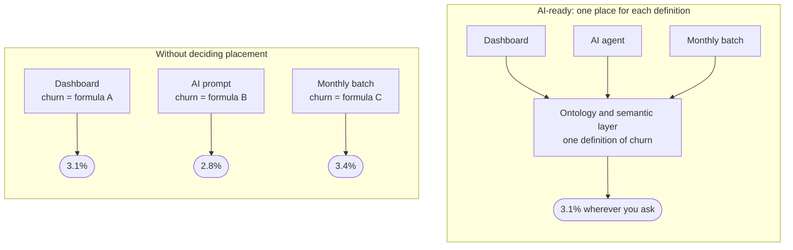

# AI-Ready Requirements

**English** | [日本語](README.ja.md)

A framework for deciding, during requirements definition, **which layer each requirement belongs to**: the app / AI layer, the ontology, the semantic layer, the data layer, or the cross-cutting policy. Every document is available in English (`framework/en/`) and Japanese (`framework/ja/`), with the same structure and IDs in both.

## Why

As AI automates more of the work, the effort that goes into development keeps shrinking. At the same time, to have AI build and run systems, it has to learn the business more precisely than ever. People can fill gaps with unstated assumptions and context; AI knows only what is written down.

That is why requirements must be made clear before development starts. It is not enough to interview the business in more depth; you also have to decide where each piece of business meaning lives. With less development effort and more requirements work, requirements definition takes up a growing share of the whole.

Without a decision on placement, when a business rule ends up in a prompt, or a metric is defined inside a dashboard, every new screen and every new agent gets its own copy, and the answers start to disagree.

This framework fixes the placement criteria in advance, so that interviews, placement decisions and their reasons follow the same shape on every project. "AI-ready" means that every rule and definition lives in exactly one place that both people and AI can reference.

On the left, the screen, the prompt and the batch each define "churn rate" their own way. A person who knows the dashboard figure runs a little high can adjust for it; an AI cannot. On the right, the definition lives in one place and everything references it. This framework sets out how to decide the placement of each requirement so that you end up on the right.

## The four layers and the cross-cutting policy

The layers are listed in the order an AI processes a prompt. The AI works down through them, then follows the results back up to answer.

| # | Layer | Question it answers | Examples |
|---|---|---|---|
| 1 | App / AI | Who is asking, and who sees what, how? | Screens, notifications, workflows, prompts, agent behavior, receiving the user context |
| 2 | Ontology | What is it? | Customer, contract, state transitions, business rules, official terms |
| 3 | Semantic | How is it counted? | Metric formulas, dimensions, grain, period definitions |
| 4 | Data | Where from, how fresh, how correct? | Sources, ingestion frequency, quality rules, retention |

The **policy** (who may see or do what) is not part of any one layer; it applies in all four. It controls which agents and tools can be used in the app / AI layer, which actions can be run in the ontology, which scope may be returned in the semantic layer, and masking in the data layer. Single-record checks and operations skip the semantic layer, so a policy placed in only one layer would leave a gap.

### Inside the ontology

The ontology is the layer that settles what a prompt means, so it is broken down further into five kinds of content, read in this order: **vocabulary → structure → states and events → rules → actions**. Each element can only reference the ones before it, and each has required fields, such as a point-in-time definition for states and an AI permission (automatic / after a person confirms / forbidden) for actions. See the [ontology design guide](framework/en/06_ontology-design.md).

## The five criteria

When the layer is unclear, score the requirement from 1 to 3 on each criterion. A total of 9 or more means it should be a shared definition (ontology or semantic); 8 or less means it may stay inside the app / AI layer.

| Criterion | 1 | 3 |
|---|---|---|
| Reuse scope | One screen or agent | Company-wide |
| Impact of drift | Cosmetic | Money, contracts, compliance |
| Change frequency | Weekly to monthly | Yearly or less |
| Decision owner | Product team | Executives, business owner |
| AI consumption | One agent | Every AI and system |

## Documents

| # | English | Japanese | Contents |
|---|---|---|---|
| 01 | [The four layers and the cross-cutting policy](framework/en/01_layers.md) | [4つのレイヤーと横断ポリシー](framework/ja/01_layers.md) | What each layer owns and does not own, what the policy does in each layer, tests for the boundaries, contracts between layers |
| 02 | [Placement criteria](framework/en/02_decision-criteria.md) | [振り分けの判断基準](framework/ja/02_decision-criteria.md) | Principles, decision flow, five scoring criteria, common misplacements |
| 03 | [Interview guide](framework/en/03_interview-guide.md) | [ヒアリングガイド](framework/ja/03_interview-guide.md) | Questions per layer, and signals to watch for in interviews |
| 04 | [Placement matrix](framework/en/04_placement-matrix.md) | [振り分けマトリクス](framework/ja/04_placement-matrix.md) | Template for recording each requirement, its layer, scores and reason |
| 05 | [Worked example](framework/en/05_worked-example.md) | [記入例](framework/ja/05_worked-example.md) | Membership churn at a fictional fitness chain, from five requests to twelve placed requirements, and how an AI walks through them |
| 06 | [Ontology design guide](framework/en/06_ontology-design.md) | [オントロジー設計ガイド](framework/ja/06_ontology-design.md) | Five kinds of ontology content and three tiers of scope, the order AI reads them in, and required fields |
| 07 | [How AI processes a prompt](framework/en/07_ai-processing-flow.md) | [AI がプロンプトを処理する流れ](framework/ja/07_ai-processing-flow.md) | The five steps from prompt to answer, routes by kind of question, rules for each step, and the feedback loop. Illustrated HTML version: [docs/ai-processing-flow.html](docs/ai-processing-flow.html) |

## Usage

1. Run interviews with the [interview guide](framework/en/03_interview-guide.md) and write each request down as a `REQ-` in the stakeholder's own words.
2. Copy the [placement matrix](framework/en/04_placement-matrix.md) into your project's `docs/` directory.
3. Split each request by layer, and place each part using the [decision flow and criteria](framework/en/02_decision-criteria.md).
4. Record the scores and the reason for every placement, then go through the checklist at the end of the matrix.

The `REQ-` and layer IDs can sit alongside a requirements definition such as the `FR-` IDs in [doc-templates](https://github.com/keito118/doc-templates): use the "Related ID" column to link them.

## License

MIT
