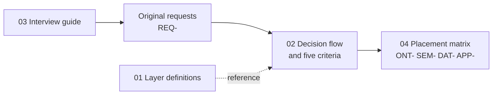

# AI-Ready Requirements

**English** | [日本語](README.ja.md)

A framework for deciding, during requirements definition, **which layer each requirement belongs to**: the ontology, the semantic layer, the data layer, or the app / AI layer. Every document is available in English (`framework/en/`) and Japanese (`framework/ja/`), with the same structure and IDs in both.

## Why

AI is making implementation cheaper, but it does not make requirements cheaper. As a share of the work, requirements definition grows: you need to understand the business in more depth, and you need to decide where each piece of meaning lives. When a business rule ends up in a prompt, or a metric is defined inside a dashboard, every new screen and every new agent gets its own copy, and the answers start to disagree.

This framework fixes the placement criteria in advance, so that interviews, placement decisions and their reasons follow the same shape on every project. "AI-ready" means that every rule and definition lives in exactly one place that both people and AI can reference.

## The four layers

| Layer | Question it answers | Examples |
|---|---|---|
| Ontology | What is it? | Customer, contract, state transitions, business rules, official terms |
| Semantic | How is it counted? | Metric formulas, dimensions, grain, period definitions, access |
| Data | Where from, how fresh, how correct? | Sources, ingestion frequency, quality rules, retention |
| App / AI | Who sees what, and how? | Screens, notifications, workflows, prompts, agent behavior |

## The five criteria

When the layer is unclear, score the requirement from 1 to 3 on each criterion. A total of 9 or more means it should be a shared definition (ontology or semantic); 8 or less means it may stay inside the app / AI layer.

| Criterion | 1 | 3 |
|---|---|---|
| Reuse scope | One screen or agent | Company-wide |
| Impact of drift | Cosmetic | Money, contracts, compliance |
| Change frequency | Weekly to monthly | Yearly or less |
| Decision owner | Product team | Executives, business owner |
| AI consumption | One agent | Every AI and system |

## Documents

| # | English | Japanese | Contents |
|---|---|---|---|
| 01 | [The four layers](framework/en/01_layers.md) | [4つのレイヤー](framework/ja/01_layers.md) | What each layer owns and does not own, and common boundary cases |
| 02 | [Placement criteria](framework/en/02_decision-criteria.md) | [振り分けの判断基準](framework/ja/02_decision-criteria.md) | Principles, decision flow, five scoring criteria, common misplacements |
| 03 | [Interview guide](framework/en/03_interview-guide.md) | [ヒアリングガイド](framework/ja/03_interview-guide.md) | Questions per layer, and signals to watch for in interviews |
| 04 | [Placement matrix](framework/en/04_placement-matrix.md) | [振り分けマトリクス](framework/ja/04_placement-matrix.md) | Template for recording each requirement, its layer, scores and reason |
| 05 | [Worked example](framework/en/05_worked-example.md) | [記入例](framework/ja/05_worked-example.md) | Membership churn at a fictional fitness chain, from five requests to twelve placed requirements |

## Usage

1. Run interviews with the [interview guide](framework/en/03_interview-guide.md) and write each request down as a `REQ-` in the stakeholder's own words.
2. Copy the [placement matrix](framework/en/04_placement-matrix.md) into your project's `docs/` directory.
3. Split each request by layer, and place each part using the [decision flow and criteria](framework/en/02_decision-criteria.md).
4. Record the scores and the reason for every placement, then go through the checklist at the end of the matrix.

The `REQ-` and layer IDs can sit alongside a requirements definition such as the `FR-` IDs in [doc-templates](https://github.com/keito118/doc-templates): use the "Related ID" column to link them.

## License

MIT
