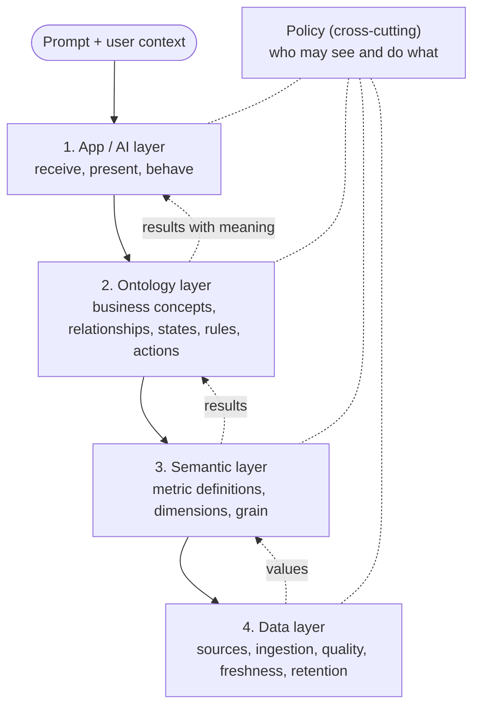

# 01. The four layers and the cross-cutting policy

> Defines the four layers that requirements are placed into, and the policy that cuts across all of them. The order of the layers is **the order in which AI processes a prompt**. When in doubt, come back to this table and ask "is this really this layer's responsibility?"

## Overview

When an AI receives a prompt, it works down the layers: **receive (app / AI) → settle the meaning (ontology) → choose how to count (semantic) → fetch values (data)**, then follows the results back up to answer.

- Meaning is settled before counting, so the ontology is read before the semantic layer. Semantic-layer metrics only count the ontology's concepts; they never invent new ones.
- Every read of data goes through the semantic layer, even a single-record check. The rule for the check lives in the ontology, and the way to count the values it uses (such as each member's check-ins in the last 14 days) lives in the semantic layer. Only two things skip it: questions that only ask for a definition (they stop at the ontology), and writes from operations (from the action definition to the data layer) (see [07 How AI processes a prompt](07_ai-processing-flow.md)).
- **Policy** (who may see and do what) is not placed in any one layer; it is enforced in all four.

Each meaning and each way of counting lives in exactly one place that everyone who needs it can reach; other layers only reference it.

## Layer definitions

| Layer | In one phrase | Owns | Does not own | Typical implementation |
|---|---|---|---|---|
| App / AI | Who sees what, how, and what it does | Screens, reports, notifications, workflows, AI prompts and tools, receiving the user context (who, which department), UX defaults and sort orders | Business rules and metric definitions (if written here they drift from other consumers) | Web apps, BI dashboards, chat UIs, AI agents |
| Ontology | The business's things, relationships and rules | Entities (customer, contract, product), relationships (a customer has many contracts), states and transitions (contract: applied → active → cancelled), business rules (cancellations close at month end), the official meaning of terms | Calculation formulas, display labels, quirks of source systems | Conceptual model, knowledge graph, domain model, glossary, master data definitions |
| Semantic | The definition of the numbers | Metric formulas (revenue, churn rate), how per-record values are counted (each member's check-ins in the last 14 days), dimensions, grain, period definitions (fiscal or calendar month) | The definition of business concepts themselves, screen layout | Metrics layer, dbt semantic models, BI data models, metric catalog |
| Data | Where data comes from and how good it is | Source systems, ingestion method and frequency, data quality rules (missing, duplicate, inconsistent), history handling, retention, lineage | The meaning of metrics, business rule decisions | Data warehouse / lake, ETL / ELT, data quality checks, data catalog |

### What the policy does in each layer

| Layer | Where the policy applies | Example |
|---|---|---|
| App / AI | Who may use which agents and tools | Location staff may use the outreach-message agent |
| Ontology | Which actions may be run, and whether AI may run them | AI may submit a pause request only after a person confirms |
| Semantic | Which scope (rows and columns) a metric is returned for | A location manager gets only their own location's numbers |
| Data | Restrictions at storage and fetch time | Phone numbers are always masked before reaching AI |

Define each policy rule once, and apply the same rule in all four layers. Asking "please don't show this" in a prompt is not a substitute for policy.

## Why this matters more with AI

- **AI believes what it is told.** If "churn rate" is defined once in a dashboard and again in a prompt, a person can reconcile them from context; an AI cannot, and the answers diverge.
- **Cheaper implementation multiplies misplacement.** When apps are fast to build, copies of the same rule spread into screens, prompts and batch jobs.
- **The lower layers become the shared language for AI.** With a solid ontology and semantic layer, each new agent or dashboard does not have to redefine the business from scratch.

## Three tests for the boundaries

| Test | If yes | If no | Example |
|---|---|---|---|
| T1: Can it be answered for a **single** record? | Ontology | Go to T2 | "Is this member active?" → ontology |
| T2: Is it a calculation or aggregation over a **set**? | Semantic | Go to T3 | "Active rate = active members ÷ enrolled members" → semantic |
| T3: Would it **change** if the system were replaced? | Data | Go to T4 | "Check-ins are in the entry system's checkin table" → data |
| T4: Is it about who may **see or do** what? | Policy (cross-cutting) | App / AI layer | "Location managers see only their own location's members" → policy |

T1 separates **classifications that can be decided one record at a time (ontology)** from **the result of counting them (semantic)**. The semantic layer then never invents new concepts; it only counts the ontology's concepts. T1 and T2 decide **where a definition lives**, not the route the AI takes: even a single-record check gets its values from the semantic layer.

## Contracts between layers

Even with the layers separated, AI gets lost if the joins are undefined. Require these references between layers:

| Join | Required reference | Symptom when missing |
|---|---|---|
| App / AI → ontology | Pass the user context (who, which department) as values of ontology concepts | Department-specific definitions are ignored and answers use another department's standard |
| Semantic → ontology | Every metric names the concept ID it counts, and the state and rule IDs it uses | Metrics carry their own embedded conditions and duplicate the concept's definition |
| Data → ontology | Every entity is mapped to the source ID that makes it unique (the matching key) | The same member is counted as two people |
| Data → semantic | Every metric is mapped to its source tables and columns, and their freshness (as of when) | AI answers "this month" with stale data |
| Semantic → data | Every read of data, even of one record, goes through a semantic-layer definition. Neither AI nor apps write queries against the data layer directly | AI writes SQL on the spot, and the same question gets different answers |

For how to break the ontology layer down further, see [06 Ontology design guide](06_ontology-design.md).

## Common boundary cases

| Case | Layer | Why |
|---|---|---|
| What counts as an "active customer" | Ontology | It is the definition of a state and must mean the same thing in every department |
| Whether dormant customers are in the denominator of "activation rate" | Semantic | It is about how the metric is calculated |
| Contract data only reflects up to the previous day | Data | It is about freshness; the metric definition does not change |
| The churn rate threshold at which a dashboard turns red | App / AI | It is presentation. If the threshold is also a business standard (for example the alert line for board meetings), move it to the semantic layer |
| Which customer data an AI may use in its answers | Policy (cross-cutting) + App / AI (tool configuration) | Who may see what is decided in the policy; the agent inherits the permissions of the person using it |
