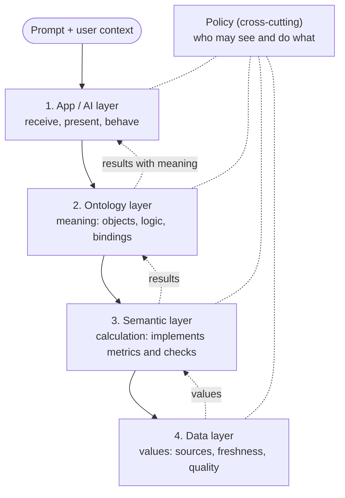

# 01. The four layers and the cross-cutting policy

> Defines the four layers that requirements are placed into, and the policy that cuts across all of them. The order of the layers is **the order in which AI processes a prompt**. When in doubt, come back to this page and ask "is this really this layer's responsibility?"

## Overview

When an AI receives a prompt, it works down the layers: **receive → settle the meaning → calculate → fetch values**, then follows the results back up to answer. The policy is not part of any one layer; it is enforced in all four.

## Layer definitions

| Order | Layer | In one phrase | Owns | Does not own | Typical implementation |
|---|---|---|---|---|---|
| 1 | App / AI | The entrance and the exit | Screens, reports, notifications, chat UIs, prompts, agent configuration, receiving the user context (who, which department), presenting answers | Business meaning and formulas (if written here they drift from other consumers) | Web apps, BI dashboards, chat UIs, AI agents |
| 2 | Ontology | The business's meaning | Objects (concepts such as customer, contract, location and department, with descriptions), logic (checks, calculations, relations, causes and operations, defined by inputs, outputs and a description), bindings (where each concept and piece of logic is stored or calculated) | Calculation implementations (such as SQL), display concerns, quirks of source systems | Conceptual model, knowledge graph, domain model, glossary |
| 3 | Semantic | The implementation of calculations | Semantic views that implement the ontology's logic: metric aggregations, dimensions, grain, period handling, joins | The meaning of metrics (that belongs in the ontology), ingestion | Metrics layer, dbt semantic models, BI data models |
| 4 | Data | Values and where they come from | Source systems, ingestion method and frequency, data quality rules, history handling, retention, identity matching, lineage | Rules about meaning or calculation | Data warehouse / lake, ETL / ELT, data quality checks, data catalog |
| Cross-cutting | Policy | Who may see and do what | Access scope per user and per AI (rows and columns), which agents and tools may be used, which operations AI may perform and whether a person must confirm, masking of personal data | Business meaning, calculation | Access management, row-level security, agent tool permissions |

### How the ontology and the semantic layer relate

The ontology holds the **meaning**; the semantic layer holds its **implementation**. "Churn rate is the share of members whose cancellation was confirmed in the period; paused members are not in the denominator" goes into the ontology's logic. The aggregation that calculates it goes into a semantic-layer view. A binding links the two, and the view implements exactly what the description says.

This way the AI has a single entrance: the ontology. It never assembles formulas itself; it calls the bound view.

### What the policy does in each layer

| Layer | Where the policy applies | Example |
|---|---|---|
| App / AI | Who may use which agents and tools | Location staff may use the outreach-message agent |
| Ontology | Which objects and logic may be referenced or run, and whether an operation may be left to AI | AI may run the pause-request logic only after a person confirms |
| Semantic | Which rows and columns a view returns | A location manager gets only their own location's rows |
| Data | Restrictions at storage and fetch time | Phone numbers are always masked before reaching AI |

Define each policy rule once, and apply the same rule in all four layers. Asking "please don't show this" in a prompt is not a substitute for policy.

## Tests for the boundaries

Apply them from the top; place the requirement in the first layer that answers yes.

| Test | If yes | Example |
|---|---|---|
| T1: Is it about **who** may see or do something? | Policy | "Location managers see only their own location's members" |
| T2: Is it a **meaning** that a business person can explain in words (a concept, relationship, check, the meaning of a metric, the preconditions of an operation)? | Ontology | "An active member is an enrolled member who checked in at least once in the last 30 days" |
| T3: Is it the **procedure for calculating** a meaning (aggregation, grain, joins)? | Semantic | "Count check-ins per member over a 30-day window" |
| T4: Is it about where values **come from**, how fresh or how correct they are? | Data | "Ingest check-ins every 15 minutes" |
| None of the above | App / AI | "Show year-on-year figures side by side on the dashboard" |

Most requirements about numbers **split** into T2 and T3. "I want to see the churn rate" becomes the meaning of churn rate (ontology) and its aggregation (semantic).

## Contracts between layers

Even with the layers separated, AI gets lost if the joins are undefined. Require these references:

| Join | Required reference | Symptom when missing |
|---|---|---|
| App / AI → ontology | Pass the user context (who, which department) as values of ontology objects | Department-specific definitions are ignored and answers use another department's standard |
| Ontology → semantic | Bind every check and calculation to the view that implements it | AI assembles a formula from the description each time, and the numbers drift |
| Ontology → data | Map every object to the source ID that makes it unique (the matching key) | The same member is counted as two people |
| Semantic → data | Map every view to its source tables and their freshness (as of when) | AI answers "this month" with stale data |

For the structure inside the ontology layer, see the [06 Ontology design guide](06_ontology-design.md).

## Why this matters more with AI

- **AI believes what it is told.** If "churn rate" is defined once in a dashboard and again in a prompt, a person can reconcile them from context; an AI cannot, and the answers diverge.
- **Cheaper implementation multiplies misplacement.** When apps are fast to build, copies of the same rule spread into screens, prompts and batch jobs.
- **With meaning in one place, AI needs only one entrance.** When the ontology holds the meaning, each new agent or dashboard does not have to redefine the business from scratch.

## Common boundary cases

| Case | Layer | Why |
|---|---|---|
| What counts as an "active customer" | Ontology | It is business meaning and must be the same in every department |
| Whether dormant customers are in the denominator of "activation rate" | Ontology (description) + semantic (aggregation) | Whether to include them is a question of meaning; the view implements the decision |
| Contract data only reflects up to the previous day | Data | It is about freshness; neither meaning nor calculation changes |
| The churn rate threshold at which a dashboard turns red | App / AI | It is presentation. If the threshold is also a business standard (for example the alert line for board meetings), make it a check in the ontology |
| Which customer data an AI may use in its answers | Policy | Who may see what is decided by the policy; the agent inherits the permissions of the person using it |
| "Cancellations close at month end" written in a prompt | Ontology | It is a business rule; define it as logic and only reference it from the prompt |
