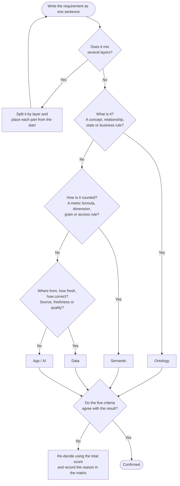

# 02. Placement criteria

> For each requirement, first use the decision flow to find the candidate layer, then score it on the five criteria to confirm. When one requirement spans several layers, split it by layer before placing it.

## Principles

1. **Put meaning in the lowest layer that everyone who shares it can reach.** Upper layers only reference the layers below.
2. **Write each rule in exactly one place.** If the same definition appears in two layers, one of them is wrong.
3. **Keep upper layers fast to change.** Putting frequently changing things low makes every change ripple through everything.
4. **Anything you want AI to interpret belongs in a definition, not a prompt.** The prompt should only say which definition to use.

## Decision flow

## The five criteria

The decision flow places a requirement by **what kind** of statement it is. The five criteria answer a separate question: **should this become a shared definition lower down, or may it stay inside one app?** In practice this is where most arguments happen (for example, is an alert threshold a screen setting or a company-wide standard?).

Score each criterion from 1 to 3. The data layer is about supply rather than meaning, so requirements that match Q3 are placed there without scoring.

| Criterion | Question | 1 (toward upper layer) | 2 | 3 (toward lower layer) |
|---|---|---|---|---|
| Reuse scope | Who uses this definition? | One screen or one agent | One department, several screens | Across departments, company-wide |
| Impact of drift | What happens if people define it differently? | Things look slightly different | Wrong decisions, rework | Errors in money, contracts, compliance or external reporting |
| Change frequency | How often does it change? | Weekly to monthly | Quarterly to half-yearly | Yearly, or only when regulations change |
| Decision owner | Who is allowed to decide it? | Product team, end users | Department head, data / analytics team | Executives, business owner, legal |
| AI consumption | Does AI interpret and use it? | Only one specific agent | Several agents or BI tools | Every AI and system in the company relies on it |

### Reading the total

| Total (5–15) | Verdict | Layer |
|---|---|---|
| 9–15 | Make it a shared definition | Ontology (what it is) or semantic (how it is counted), depending on its kind |
| 5–8 | May be kept locally | App / AI |

When the flow and the score disagree:

| Flow result | Score | What to do |
|---|---|---|
| App / AI | 9 or more | Push it down. Example: if an alert threshold is also the board's standard, define it as part of a metric in the semantic layer |
| Ontology or semantic | 8 or less | It may stay in the app / AI layer. Example: a temporary campaign category used by a single screen |

> The score is a tool for aligning the discussion. For requirements around 8–9 points, let "impact of drift" decide rather than the score, and record the reason in the matrix.

## Common misplacements

| Misplacement | Symptom | Correct layer |
|---|---|---|
| Business rules written in prompts | Each agent answers differently; changing a rule means hunting through every prompt | Define it in the ontology and reference it from prompts |
| Metrics defined by dashboard formulas | The same "revenue" differs from screen to screen | Semantic |
| Data quality issues patched in the app | That screen looks right, but other users and AI still get dirty data | Fix it in the data layer as a quality rule |
| Display labels and sort orders in the ontology | The conceptual model keeps changing for UI reasons | App / AI |
| Access control implemented per app | Data that should be hidden becomes visible through an AI agent | Semantic (row- and column-level access) |

## Record the decision

Record each result in the [04 placement matrix](04_placement-matrix.md), with its scores and the reason. Being able to explain later *why* something lives in a given layer is the most important output of this framework.
