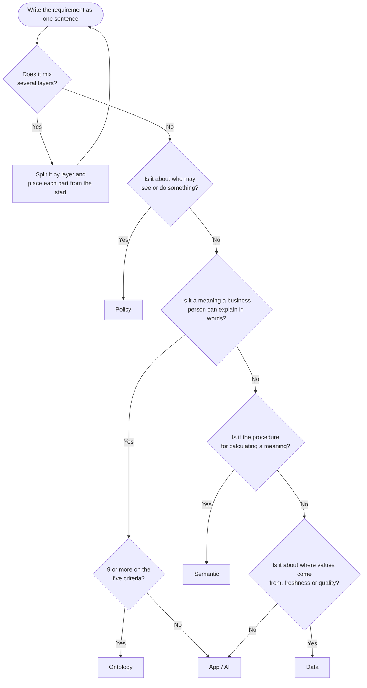

# 02. Placement criteria

> For each requirement, first use the decision flow to find the candidate layer, then score it on the five criteria when in doubt. When one requirement spans several layers, split it by layer before placing it.

## Principles

1. **Write each meaning once, in the ontology.** Screens, prompts and views only reference it.
2. **Implement each calculation once, in the semantic layer, and bind it from the ontology.** If the same metric's formula appears in two places, one of them is wrong.
3. **Keep upper layers fast to change.** The app / AI layer may change often; changes to the ontology need an impact check.
4. **Anything you want AI to interpret belongs in a definition, not a prompt.** The prompt should only say which objects and logic to use.
5. **Define access once as policy, and enforce it in every layer.** Asking nicely in a prompt is not access control.

## Decision flow

Every requirement placed in the semantic layer has a matching piece of ontology logic. If only a calculation procedure has come up and its meaning is not settled, create the ontology requirement first.

## The five criteria

The decision flow places a requirement by **what kind** of statement it is. The five criteria answer a separate question about requirements that concern meaning: **should this become a shared definition in the ontology, or may it stay inside one app?** In practice this is where most arguments happen (for example, is an alert threshold a screen setting or a company-wide standard?).

Score each criterion from 1 to 3.

| Criterion | Question | 1 (toward app) | 2 | 3 (toward ontology) |
|---|---|---|---|---|
| Reuse scope | Who uses this definition? | One screen or one agent | One department, several screens | Across departments, company-wide |
| Impact of drift | What happens if people define it differently? | Things look slightly different | Wrong decisions, rework | Errors in money, contracts, compliance or external reporting |
| Change frequency | How often does it change? | Weekly to monthly | Quarterly to half-yearly | Yearly, or only when regulations change |
| Decision owner | Who is allowed to decide it? | Product team, end users | Department head, data / analytics team | Executives, business owner, legal |
| AI consumption | Does AI interpret and use it? | Only one specific agent | Several agents or BI tools | Every AI and system in the company relies on it |

### Reading the total

| Total (5–15) | Verdict | Layer |
|---|---|---|
| 9–15 | Make it a shared definition | Ontology (and a semantic-layer implementation if it needs calculating) |
| 5–8 | May be kept locally | App / AI |

> **The score is a guide.** Reuse scope, decision owner and AI consumption tend to rise together, so the total can count the same thing several times. The line at 9 is a rule of thumb, so use the score to align the reasons for a decision rather than to decide mechanically. For requirements around 8–9 points, let "impact of drift" decide, and record the reason in the matrix.

When the flow and the score disagree:

| Flow result | Score | What to do |
|---|---|---|
| App / AI | 9 or more | Move it into the ontology. Example: if an alert threshold is also the board's standard, define it as a check |
| Ontology | 8 or less | It may stay in the app / AI layer. Example: a temporary campaign category used by a single screen |

## Common misplacements

| Misplacement | Symptom | Correct place |
|---|---|---|
| Business rules written in prompts | Each agent answers differently; changing a rule means hunting through every prompt | Define it as ontology logic and reference it from prompts |
| Metrics defined by dashboard formulas | The same "revenue" differs from screen to screen | Meaning in the ontology, formula in the semantic layer |
| A calculation described only in the logic's description, with no implementation | AI assembles the formula from the description each time, and the numbers drift | Implement a view in the semantic layer and bind it from the logic |
| Data quality issues patched in the app | That screen looks right, but other users and AI still get dirty data | Fix it in the data layer as a quality rule |
| Display labels and sort orders in the ontology | The conceptual model keeps changing for UI reasons | App / AI |
| Access control implemented per app | Data that should be hidden becomes visible through an AI agent | Policy (enforced in every layer) |

## Record the decision

Record each result in the [04 placement matrix](04_placement-matrix.md), with its scores and the reason. Being able to explain later *why* something lives in a given layer is the most important output of this framework.
