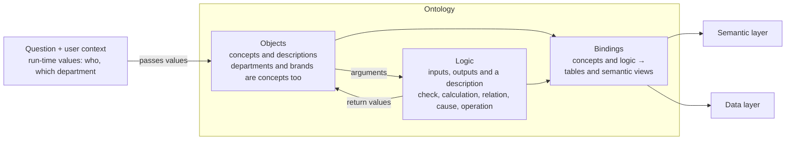

# 06. Ontology design guide

> The ontology layer settles the meaning of a question that the AI has received through the app / AI layer. This guide divides the ontology into **objects, logic and bindings**, and sets out the design rules and required fields for each. For the definition of the layer itself, see [01 The four layers and the cross-cutting policy](01_layers.md).

## 1. Structure

| Element | Role | Example (fitness chain) |
|---|---|---|
| Object | A business concept. A noun, with a description. Has attributes, states and relationships | Member, contract, location, department, check-in |
| Logic | Takes objects as input and returns an object. A verb, with a description | is active (member, date) → true/false; calculate churn rate (location, period) → metric |
| Binding | Where an object or piece of logic is stored or calculated | Member → member master table; calculate churn rate → weekly churn rate view |

Concepts that need no logic (such as "where is this location?") go straight from the object to its binding.

## 2. Design rules

| No | Rule | Why |
|---|---|---|
| 1 | The smallest unit is the concept. Words are labels of concepts | Departments can call the same concept by different words and it stays one concept |
| 2 | The user context is the input that passes run-time values to concepts such as department | "Who is asking" becomes a value rather than prose in a prompt |
| 3 | Every logic input and output is an object. Logic connects to other logic only through objects | With consistent types, AI can combine logic to reason |
| 4 | When several pieces of logic return the same output for different departments, include the department as an argument. Always keep **one default version** with no department | Department differences live in one ontology without losing the company-wide definition |
| 5 | Bindings come from objects and from check and calculation logic | They link meaning (ontology) to implementation (semantic and data) |
| 6 | Naming: logic uses verbs, objects use nouns | The name alone shows whether something is a thing or a process |
| 7 | Write what a calculation does in the logic's description **as meaning**. The calculation itself runs in the bound semantic view | The description is the meaning people and AI read; the view is the implementation that produces numbers. If AI builds formulas from descriptions, numbers drift |
| 8 | Logic that changes state (an operation) states its preconditions and result in the description. Who (person or AI) may run it is decided by policy | What happens is meaning; who may do it is access |
| 9 | Access control is handled outside the ontology, by the policy | Access stays consistent across all layers |

## 3. Kinds of logic

| Kind | Output | Example | Typical binding |
|---|---|---|---|
| Check | True/false or a category | is active (member, date) → true/false | Semantic view |
| Calculation | A metric | calculate churn rate (location, period) → metric | Semantic view |
| Relation | Related objects | get contracts (member) → contracts | Table |
| Cause | Objects that act as drivers | list churn drivers (location, period) → member segments | Semantic view (candidate drivers defined in advance) |
| Operation | The changed object | request pause (member, start month) → member (paused) | Write to a table |

Business rules (such as "cancellations close at month end") are written as check or calculation logic (for example, determine cancellation date (member, request date) → date). States and their transitions are attributes of an object, with their allowed values and allowed transitions.

## 4. Reference order, and what to do when something is missing

AI reads objects → logic → bindings: it settles the objects from the words, chooses the logic it needs, and calculates or fetches through the binding.

The same order is also the order to ask in interviews and to build in. But **you do not need to finish it top to bottom in one pass.** If, while writing logic, you find that a "check-in" object is missing, go back, add the object, and reference it from the logic. What is forbidden is quietly defining "check-in" inside the logic, which scatters the definition across two places.

Because each element may only use words from the elements before it, being unable to write something tells you immediately that an earlier element has a gap. In practice you go around several times: a rough pass through everything, then back to fill in whatever could not be written.

## 5. Kinds of question, and what the AI reads in the ontology

| Kind of question | Example | Elements read | Then |
|---|---|---|---|
| Asking for a definition | "What is an active member?" | Objects, logic descriptions | Answer directly |
| Asking for an attribute of one record | "Which location does Yamada belong to?" | Object → binding | Fetch from the data layer |
| Checking one record | "Is Yamada active?" | Object → check logic → binding | Check in a semantic view |
| Asking for a number | "What was Shibuya's churn rate last month?" | Object → calculation logic → binding | Calculate in a semantic view |
| Asking why | "Why did churn go up?" | Calculation logic + cause logic | Break it down by segment and explain in terms of the driver objects |
| Asking for an operation | "Pause this member's membership" | Object → operation logic | Check in the policy whether AI may run it, then write to the data layer |

## 6. Required fields

### 6.1 Objects

| Field | Required | Why |
|---|---|---|
| ID, official name (noun) | Yes | |
| Labels (synonyms, names used by each department) | Yes | The index that leads from words to concepts |
| Description (1–2 sentences) | Yes | AI grasps meaning from prose before structured fields |
| Counter-examples (what is not included) | Recommended, strongly for AI | Negative definitions reduce AI misreadings more than anything else |
| What makes it unique | Yes | What counts as one record |
| Main attributes and relationships | Yes | Relationships name the other object and the cardinality |
| States (allowed values, allowed transitions, **point-in-time definition**) | Yes, if it has states | "Members this month" differs between start of month and now |
| Binding | Recommended | Storage table and matching key |
| Decision owner, status (draft / approved / deprecated), valid period | Yes | AI uses only approved items, and flags drafts as unconfirmed |

### 6.2 Logic

| Field | Required | Why |
|---|---|---|
| ID, name (verb) | Yes | |
| Kind (check / calculation / relation / cause / operation) | Yes | |
| Inputs (objects), output (object) | Yes | To connect logic together |
| Description (what it does, as meaning) | Yes | For calculations too, write the meaning, not the formula |
| Point-in-time handling | Yes, if it depends on time | Decide "as of when" through an argument or a default |
| Department versions and the default version | Yes, if it differs by department | Rule 4 |
| Binding (the view that implements it) | Yes, for checks and calculations | Rule 7 |
| Preconditions and result | Yes, for operations | Rule 8. Who may run it goes in the policy |
| Decision owner, status, valid period | Yes | When a rule changes, past numbers are read differently before and after |

### 6.3 Four fields that matter most for AI

| Field | Why |
|---|---|
| Description | With only IDs and enumerations, AI misjudges what a concept or process is for |
| Counter-examples | AI tends to read boundaries broadly; stating what is excluded tightens them |
| Point-in-time definition | Without it, AI picks a different point in time each time |
| Binding | With it, AI calls a view instead of assembling a formula, so the numbers are the same every time |

## 7. Common dilemmas

| Dilemma | How to handle it |
|---|---|
| Departments use a word differently and will not unify | If it is the same concept, absorb the different names as labels. If the meaning differs, make separate objects or logic with a department argument |
| The ontology grows too large | Give AI only the relevant part, using labels as the index. Never put the whole ontology in a prompt |
| A calculation's description and its view disagree | Review on the basis that the view implements the description. When the description changes, change the view at the same time |
| Show past numbers with the definition at the time, or today's? | Give logic a valid period, and state in the description which one is used |
| BI tools query semantic views directly | That is an entrance that bypasses the ontology, leaving room for meaning to drift. Make each view's description a link to its ontology logic rather than a second definition |
