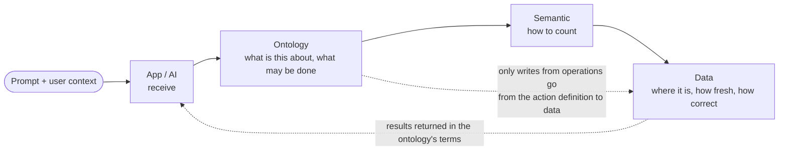
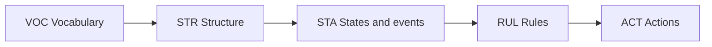

# 06. Ontology design guide

> The ontology is the broadest of the four layers, and it is where the AI settles the meaning of a prompt received through the app / AI layer. This guide breaks the ontology down into five kinds of content and three tiers of scope, and defines the order in which AI should reference them and the fields each element must have. For the definition of the layer itself, see [01 The four layers and the cross-cutting policy](01_layers.md).

## 1. The ontology in AI processing

When an AI receives a prompt, it works down the layers: app / AI → ontology → semantic → data. The ontology's job is to **map the words in the prompt to official concepts, and settle the subject, the point in time, the constraints and the allowed operations**. The policy applies in all four layers.

## 2. Five kinds of content

| Code | Element | Question it answers | Example (fitness chain) |
|---|---|---|---|
| VOC | Vocabulary | Which official concept does this word refer to? | "Members", "clients" → member. "Active" → active member |
| STR | Structure | What things exist, and how are they connected? | Member 1 — many contracts, contract many — 1 location |
| STA | States and events | What states does a thing have, and what changes them? | Enrolled → paused → enrolled. Check-in and cancellation request as events |
| RUL | Rules | What always holds, which deadlines apply, how is each record classified? | Cancellations close at month end. The test for an active member |
| ACT | Actions | Who may change what, under which conditions, with what result? | Pause request: performed by staff, only when enrolled, enrolled → paused |

- **Why events sit with states**: states change because of events, and when an AI explains *why* something changed, it follows the events.
- **Why classifications (such as active member) are rules**: a classification is derived per record from states, events and conditions. It is neither structure nor state, so it is kept as a derivation rule.
- **Why actions belong in the ontology**: preconditions, results and AI permissions are business rules. Which button on which screen triggers the action belongs in the app / AI layer.

## 3. Three tiers of scope

| Tier | Scope | Decided by | Cost of change |
|---|---|---|---|
| Core | Same meaning across the whole company | Executives, business owner | High. Needs company-wide agreement and an impact review |
| Domain | One business area or department | Department head | Medium. The department decides, but must not contradict the core |
| App-specific | One system only | Product team | Low. If it scores 8 or less on the [five criteria](02_decision-criteria.md), move it out to the app / AI layer |

**A domain may extend the core, but must never override it.** The accounting domain may add "revenue recognition date", but may not change what "member" means. When departments use the same word with different meanings, define them as separate concepts (separate IDs) and link them through the "meaning by department" field in VOC.

Combining both axes gives a picture like this:

|  | VOC Vocabulary | STR Structure | STA States and events | RUL Rules | ACT Actions |
|---|---|---|---|---|---|
| Core | Member, contract, location | Member—contract—location | Member status, check-in, cancellation request | Month-end cancellation, active member | Cancel membership, pause request |
| Domain (accounting) | Recognition, suspension fee | Contract—invoice | Invoice status, payment | Pro-rata calculation | Refund |
| Domain (location operations) | Visit, outreach | Member—assigned staff | Outreach done | Outreach target conditions | Log outreach |

## 4. Reference order

### 4.1 The basic order

Each element can be written using only the terms of the elements before it. A rule reads as "for this thing, in this state, when this event happens"; an action reads as "when this rule holds, from this state to that state". **Forbid references in the other direction** (such as structure depending on a rule) so that an AI can read the ontology without going in circles.

The same order is also **the order to ask in interviews** and **the order to build in**. Discussing rules before the vocabulary is agreed means people use the same words for different things.

### 4.2 What the AI settles at each step

| Step | Element | What the AI settles | When it cannot |
|---|---|---|---|
| 1 | VOC | The concept ID each word refers to | Ask back if there are several candidates |
| 2 | STR | The things involved and the relationships to follow | If a relationship is not defined, do not guess; answer "not defined" |
| 3 | STA | Which states are in scope, and **as of when** | Use the default point in time and say so in the answer |
| 4 | RUL | The constraints, deadlines, classifications and exceptions that apply | If core and domain conflict, follow the core and report the conflict |
| 5 | ACT | Whether the operation is allowed, its preconditions are met, and the AI may perform it | If not permitted, do not act; say who can |

### 4.3 Where the AI can stop

The AI does not need to read all five elements every time.

| Kind of question | Example | Elements read | Then |
|---|---|---|---|
| Asking for a definition | "What is an active member?" | VOC → STR (→ RUL) | Answer directly |
| Asking about one record | "Can Yamada cancel this month?" | VOC → RUL | Count the values the check needs in the semantic layer and fetch them from the data layer. The check itself is made with the rule |
| Asking for a number | "What was the Shibuya location's churn rate last month?" | VOC → RUL | Semantic layer → data layer |
| Asking why | "Why did churn go up?" | VOC → RUL, focusing on events | Break it down in the semantic layer → data layer → explain in terms of events |
| Asking for an operation | "Pause this member's membership" | VOC → ACT | Write to the data layer (the semantic layer is read-only, so it is skipped). ACT decides whether a person must confirm first |

**Even single-record checks get their values from the semantic layer.** The rule for the check (what makes a member active) lives in the ontology; how the values it uses are counted (check-ins in the last 14 days) lives in the semantic layer. Checking with a metric instead of the rule, or writing the count separately for each check, leads to mismatches such as "cancelled in the totals, but enrolled on the member's own screen".

### 4.4 Going back, and when to stop

The order is the direction of references, not a single pass. If the AI is reading a rule and needs to know what "enrolled" means, it may follow the ID in the rule back to the state. References always point to earlier elements, so going back never creates a loop. Interviews work the same way: if, while pinning down a rule, you find a term is not defined well enough, go back to the vocabulary and add it.

Following references, however, has no natural end. The AI stops retrieving when any of the following applies.

| Stop when | Meaning |
|---|---|
| Settled | Every item the kind of question needs (what 4.2 settles, within the range 4.3 reads) is filled |
| Nothing new | Every reference leads only to definitions already retrieved |
| Limit reached | A predefined limit on reference depth or count is reached. State any missing items as assumptions in the answer |
| Not defined | The definition is not there. Do not guess; record it as a gap in the definitions (the way back in [07](07_ai-processing-flow.md)) |

Set the actual limits to match how the AI platform you use retrieves information.

## 5. Required fields

### 5.1 Common to every element

| Field | Required | Why |
|---|---|---|
| ID | Yes | Referenced from other layers and elements |
| Official name | Yes | |
| Definition (1–2 sentences) | Yes | AI grasps meaning from prose before structured fields |
| Element (VOC / STR / STA / RUL / ACT) | Yes | Keeps the reference order intact |
| Scope (core / domain name / app) | Yes | Decides precedence in conflicts, and who may decide |
| Decision owner | Yes | If unknown, record it as "undecided" |
| Status (draft / approved / deprecated) | Yes | AI uses only approved items, and flags drafts as unconfirmed |
| Valid period (from / to) | Yes | When a rule changes, past numbers are read differently before and after |
| Counter-examples (what is not included) | Recommended, strongly for AI | Negative definitions reduce AI misreadings more than anything else |
| Source (interview No, policy name) | Recommended | So the reason for the definition can be explained |

### 5.2 Per element

| Element | Required fields | Nice to have |
|---|---|---|
| VOC Vocabulary | Concept ID, synonyms and alternative wordings | Meaning by department, meanings not to use, name in other languages |
| STR Structure (entity) | What makes one record unique, main attributes | ID mapping per source (reference to the data layer) |
| STR Structure (relationship) | Entities on both ends, cardinality, required or optional | Whether it changes over time (history) |
| STA States | List of states, initial and final states, allowed transitions, **point-in-time definition** | Typical time per transition |
| STA Events | When it is recorded, definition of its timestamp, the transitions it triggers | How cancellations of the event are handled |
| RUL Rules | Kind (constraint / deadline / derived classification), subject, condition, exceptions, handling of violations (error / warning / human decision) | Reference to the data quality rule that detects violations |
| ACT Actions | Performer (role), preconditions (STA and RUL IDs), result (state transition), **AI permission** (automatic / after human confirmation / forbidden; applied as policy in every layer) | Reversibility, approver, who is notified |

### 5.3 Four fields that matter most for AI

| Field | Why |
|---|---|
| Definition | With only IDs and enumerations, AI misjudges what a classification is for |
| Counter-examples | AI tends to read boundaries broadly; stating what is excluded tightens them |
| Point-in-time definition | "Members this month" differs between start of month and now. Without it, AI picks a different reading each time |
| AI permission | Replaces "don't process this on your own" in prompts with a definition, so the constraint holds for every new agent |

## 6. Common dilemmas

| Dilemma | How to handle it |
|---|---|
| Is a classification a rule, or a semantic-layer metric? | If it can be decided per record, it is a rule (RUL). If deciding it needs information about the whole set ("top 10% of members"), define it in the semantic layer and only reference it from the ontology. Even for per-record classifications, how the values used are counted lives in the semantic layer |
| Departments use a word differently and will not unify | Do not override. Define separate concepts, link them in VOC, and let AI translate between them |
| Where do the detailed steps of an approval workflow go? | Whose approval is required (a precondition) goes in ACT. The approval screen flow and notification text go in the app / AI layer |
| Show past numbers with the definition at the time, or today's? | The ontology only records valid periods. Which one to use is decided per metric in the semantic layer |
