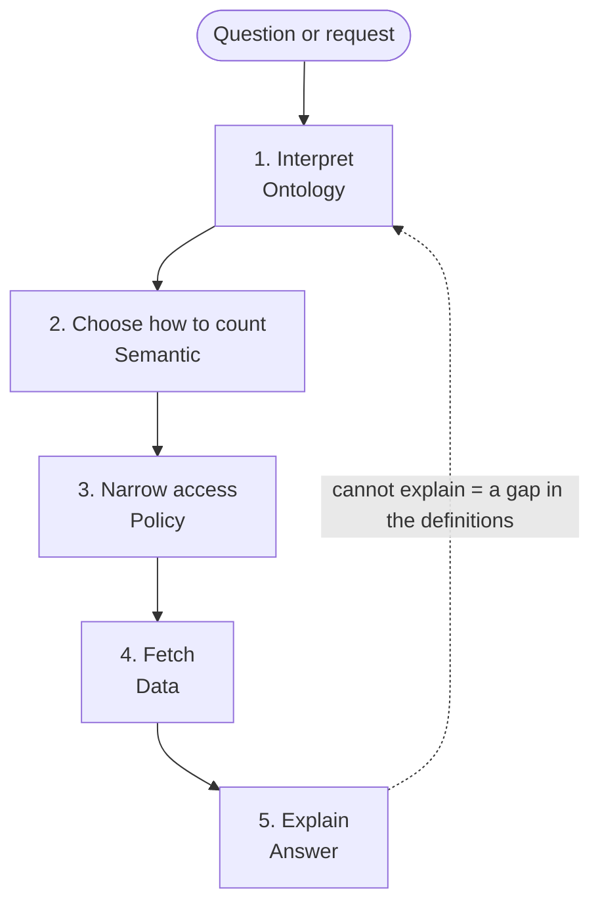
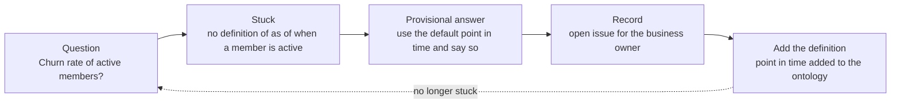

# 07. How AI processes a question

> When an AI receives a question, it makes it concrete step by step: meaning → how to count → access → values. This guide sets out which layer each step reads, the route each kind of question takes, what the AI must observe at each step, and the way back that fills gaps in the definitions. An illustrated HTML version (in Japanese) is at [docs/ai-processing-flow.html](../../docs/ai-processing-flow.html).

## 1. The overall flow

| Step | Layer | What the AI does | Example output ("What was the churn rate of active members at Shibuya last month?") |
|---|---|---|---|
| 1. Interpret | Ontology | Maps words to official concepts; decides the kind of question and the point in time | Concept IDs (active member, cancellation, location); kind = number; as of = end of last month |
| 2. Choose how to count | Semantic | Picks from the defined metrics and dimensions | Metric = churn rate; dimension = location; period = last month |
| 3. Narrow access | Policy | Inherits the permissions of the person asking | A location manager, so Shibuya only |
| 4. Fetch | Data | Receives values together with freshness and quality information | Churn rate 3.1%; last month is final; 0 quality errors |
| 5. Explain | Answer | Explains in the ontology's terms and adds data caveats | "3.1%: cancellations confirmed at the end of last month, divided by members enrolled at the start of the month (paused members excluded)" |

## 2. Routes by kind of question

The AI does not pass through every layer every time. Single-record checks and operations do not compute over a set, so they skip the semantic layer. Policy applies on every route that touches values.

| Kind of question | Example | 1. Interpret | 2. Count | 3. Access | 4. Fetch | 5. Explain |
|---|---|:-:|:-:|:-:|:-:|:-:|
| Asking for a definition | What is an active member? | ● | — | — | — | ● |
| Asking about one record | Can Yamada cancel this month? | ● | — | ● | ● | ● |
| Asking for a number | What was last month's churn rate? | ● | ● | ● | ● | ● |
| Asking why | Why did churn go up? | ● | ● | ● | ● | ● |
| Asking for an operation | Pause this member's membership | ● | — | ● | ● | ● |

- **Asking why**: break the number down by dimension, then explain it in terms of the ontology's events (fewer check-ins, cancellation requests).
- **Asking for an operation**: check the ontology's action definition for whether the AI is permitted (automatic / after a person confirms / forbidden) before writing anything.

## 3. What the AI observes at each step

| Step | Do | Do not | Why |
|---|---|---|---|
| 1. Interpret | Use the vocabulary as an index and retrieve only the relevant part | Put the whole ontology in the prompt, or fill in meaning by guessing | Ontologies grow large, and reading all of it lowers accuracy. Ask back when there are several candidates |
| 2. Count | Choose from defined metrics and dimensions | Write SQL or formulas on the fly | If the AI writes formulas, the same question can produce different numbers each time. For questions with no definition, answer "not defined" and propose a new metric |
| 3. Access | Enforce permissions at fetch time | Ask "please don't show this" in the prompt | Prompt instructions can be broken. Values that must not be seen should never reach the AI |
| 4. Fetch | Receive values together with their as-of time, gaps and quality errors | Answer from values alone | An AI that does not know freshness confidently answers with stale numbers |
| 5. Explain | Explain in the ontology's terms, showing the definitions and caveats used | Give a plausible explanation in words the definitions do not contain | If it cannot explain, do not force an answer; record it as a gap in the definitions |

## 4. The way back: answers strengthen the ontology

Wherever the AI gets stuck explaining, it leaves a task for requirements definition. The more it runs, the more complete the definitions become.

Record each gap in the open issues of the [04 placement matrix](04_placement-matrix.md).
