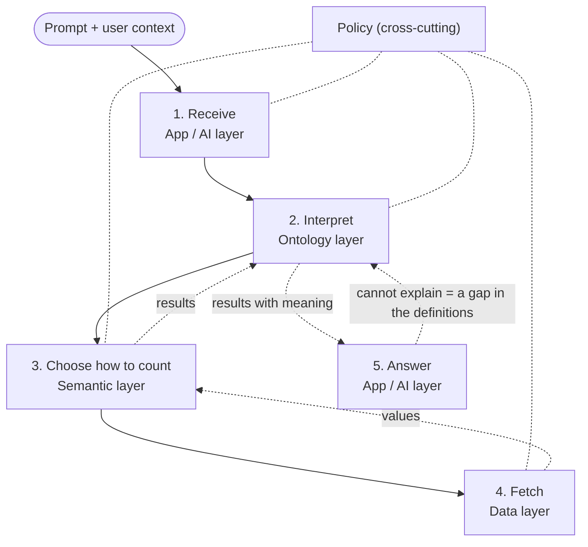
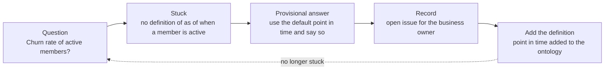

# 07. How AI processes a prompt

> When an AI receives a prompt, it works down the layers (app / AI → ontology → semantic → data), then follows the results back up to answer. The policy applies in all four layers. This guide sets out what happens at each step, the route each kind of question takes, what the AI must observe at each step, and the way back that fills gaps in the definitions. An illustrated HTML version (in Japanese) is at [docs/ai-processing-flow.html](../../docs/ai-processing-flow.html).

## 1. The overall flow

| Step | Layer | What the AI does | What the policy controls | Example output ("What was Shibuya's churn rate last month?" from a location manager) |
|---|---|---|---|---|
| 1. Receive | App / AI | Receives the prompt and the user context (who, which department) | Whether this person may use this agent | Asker = location manager; location = Shibuya |
| 2. Interpret | Ontology | Maps words to official concepts; decides the kind of question and the point in time (vocabulary → structure → states and events → rules → actions) | Which actions may be run, and whether AI may run them | Concept IDs (cancellation, location); kind = number; as of = end of last month |
| 3. Choose how to count | Semantic | Picks from the defined metrics and dimensions | Which scope a metric may be returned for | Metric = churn rate; dimension = location; period = last month; Shibuya only |
| 4. Fetch | Data | Receives values together with freshness and quality information | Restrictions at storage and fetch time, masking | Churn rate 3.1%; last month is final; 0 quality errors |
| 5. Answer | App / AI | Explains in the ontology's terms, adds data caveats, and presents it | Whether it may be shown in this form | "3.1%: cancellations confirmed at the end of last month, divided by members enrolled at the start of the month (paused members excluded)" |

## 2. Routes by kind of question

The AI does not pass through every layer every time. Single-record checks and operations do not count over a set, so they skip the semantic layer. Questions that only ask for a definition never reach the data layer. The policy applies in every layer the route passes through.

| Kind of question | Example | 1. App / AI | 2. Ontology | 3. Semantic | 4. Data |
|---|---|:-:|:-:|:-:|:-:|
| Asking for a definition | What is an active member? | ● | ● | — | — |
| Asking about one record | Can Yamada cancel this month? | ● | ● | — | ● |
| Asking for a number | What was last month's churn rate? | ● | ● | ● | ● |
| Asking why | Why did churn go up? | ● | ● | ● | ● |
| Asking for an operation | Pause this member's membership | ● | ● | — | ● |

- **Asking why**: break the number down by dimension, then explain it in terms of the ontology's events (fewer check-ins, cancellation requests).
- **Asking for an operation**: check the preconditions in the ontology's action definition, then check in the policy whether AI may run it (automatic / after a person confirms / forbidden) before writing anything.

## 3. What the AI observes at each step

| Step | Do | Do not | Why |
|---|---|---|---|
| 1. Receive | Pass the user context to the ontology as values | Write business definitions or rules in the prompt | Definitions written in prompts drift between agents |
| 2. Interpret | Use the vocabulary as an index and retrieve only the relevant part | Put the whole ontology in the prompt, or fill in meaning by guessing | Ontologies grow large, and reading all of it lowers accuracy. Ask back when there are several candidates |
| 3. Choose how to count | Choose from defined metrics and dimensions | Write SQL or formulas on the fly | If the AI writes formulas, the same question can produce different numbers each time. For questions with no definition, answer "not defined" and propose a new metric |
| 4. Fetch | Receive values together with their as-of time, gaps and quality errors | Answer from values alone | An AI that does not know freshness confidently answers with stale numbers |
| 5. Answer | Explain in the ontology's terms, showing the definitions and caveats used | Give a plausible explanation in words the definitions do not contain | If it cannot explain, do not force an answer; record it as a gap in the definitions |
| Every step (policy) | Enforce the policy in each layer | Ask "please don't show this" in the prompt | Prompt instructions can be broken. Values that must not be seen should never reach the AI |

## 4. The way back: answers strengthen the ontology

Wherever the AI gets stuck explaining, it leaves a task for requirements definition. The more it runs, the more complete the definitions become.

Record each gap in the open issues of the [04 placement matrix](04_placement-matrix.md).
