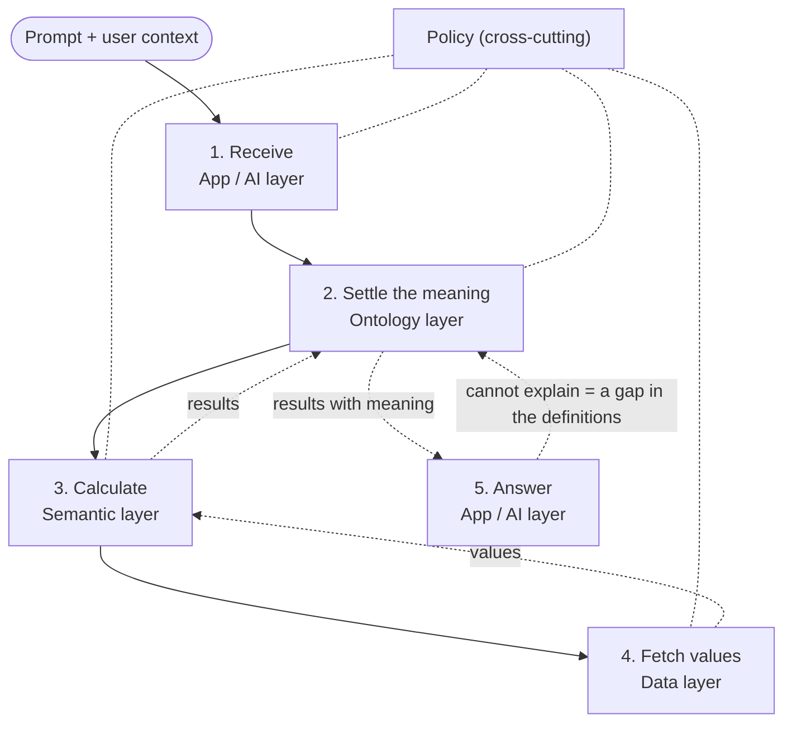
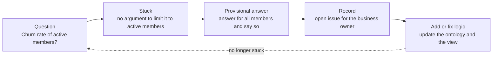

# 07. How AI processes a prompt

> When an AI receives a prompt, it works down the layers (app / AI → ontology → semantic → data), then follows the results back up to answer. The policy applies in all four layers. This guide sets out what happens at each step, the route each kind of question takes, what the AI must observe at each step, and the way back that fills gaps in the definitions. An illustrated HTML version (in Japanese) is at [docs/ai-processing-flow.html](../../docs/ai-processing-flow.html).

## 1. The overall flow

| Step | Layer | What the AI does | What the policy controls | Example output ("What was Shibuya's churn rate last month?" from a location manager) |
|---|---|---|---|---|
| 1. Receive | App / AI | Receives the prompt and the user context (who, which department) | Whether this person may use this agent | Asker = location manager; department = Shibuya |
| 2. Settle the meaning | Ontology | Maps words to objects, then chooses the logic and its arguments | Which objects and logic may be referenced or run | calculate churn rate (location = Shibuya, period = last month) |
| 3. Calculate | Semantic | Calculates in the view bound to the logic | Which rows and columns the view may return | Weekly churn rate view, on Shibuya's rows only |
| 4. Fetch values | Data | Receives values together with freshness and quality information | Restrictions at storage and fetch time, masking | Last month is final; 0 quality errors |
| 5. Answer | App / AI | Explains in the ontology's terms, adds caveats, and presents it | Whether it may be shown in this form | "3.1%: cancellations confirmed at the end of last month, divided by members enrolled at the start of the month (paused members excluded)" |

## 2. Routes by kind of question

The AI does not pass through every layer every time. Questions without a calculation skip the semantic layer, and questions that only ask for a definition never reach the data layer. The policy applies in every layer the route passes through.

| Kind of question | Example | 1. App / AI | 2. Ontology | 3. Semantic | 4. Data |
|---|---|:-:|:-:|:-:|:-:|
| Asking for a definition | What is an active member? | ● | ● | — | — |
| Asking for an attribute of one record | Which location does Yamada belong to? | ● | ● | — | ● |
| Checking one record | Is Yamada active? | ● | ● | ● | ● |
| Asking for a number | What was last month's churn rate? | ● | ● | ● | ● |
| Asking why | Why did churn go up? | ● | ● | ● | ● |
| Asking for an operation | Pause this member's membership | ● | ● | — | ● |

- **Asking why**: combine calculation logic with cause logic, and explain in terms of the driver objects (such as member segments).
- **Asking for an operation**: check the preconditions of the operation logic, then check in the policy whether AI may run it (automatic / after a person confirms / forbidden) before writing anything.

## 3. What the AI observes at each step

| Step | Do | Do not | Why |
|---|---|---|---|
| 1. Receive | Pass the user context to the ontology as values | Write business definitions or rules in the prompt | Definitions written in prompts drift between agents |
| 2. Settle the meaning | Use labels as an index, retrieve only the relevant objects and logic, and combine them | Put the whole ontology in the prompt, or fill in meaning or formulas by guessing | Ontologies grow large, and reading all of it lowers accuracy. Ask back when there are several candidates |
| 3. Calculate | Call the bound view | Write SQL or formulas on the fly | If the AI writes formulas, the same question can produce different numbers each time. When there is no logic or view, answer "not defined" and propose new logic |
| 4. Fetch values | Receive values together with their as-of time, gaps and quality errors | Answer from values alone | An AI that does not know freshness confidently answers with stale numbers |
| 5. Answer | Explain in the ontology's terms, showing the definitions and caveats used | Give a plausible explanation in words the definitions do not contain | If it cannot explain, do not force an answer; record it as a gap in the definitions |
| Every step (policy) | Enforce the policy in each layer | Ask "please don't show this" in the prompt | Prompt instructions can be broken. Values that must not be seen should never reach the AI |

## 4. The way back: answers strengthen the ontology

Wherever the AI gets stuck explaining, it leaves a task for requirements definition. The more it runs, the more complete the definitions become.

Record each gap in the open issues of the [04 placement matrix](04_placement-matrix.md).
