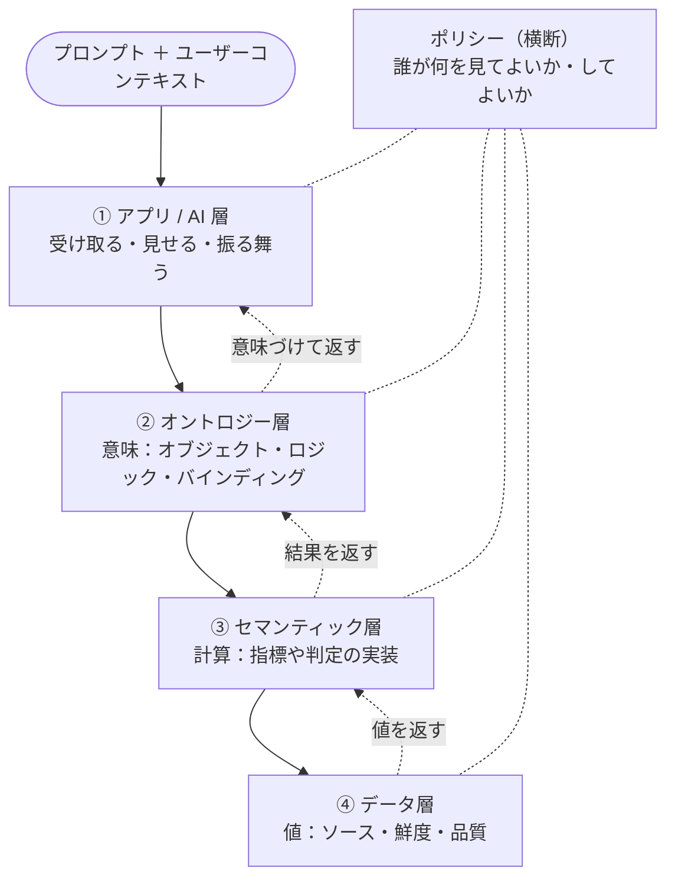

# 01. 4つのレイヤーと横断ポリシー

> 要件を振り分ける先となる4つのレイヤーと、すべての層にまたがるポリシーを定義します。層の順番は、**AI がプロンプトを処理する順番**です。迷ったときは、この表に戻って「この層の責任か？」を確認してください。

## 全体像

AI はプロンプトを受け取ると、上から順に **受け取る → 意味を確定する → 計算する → 値を取る** と具体化し、結果を逆向きにたどって回答します。ポリシーはどこか1つの層ではなく、4つの層それぞれで必ず効きます。

## レイヤー定義

| 順 | レイヤー | 一言でいうと | 持つもの | 持たないもの | 典型的な実装先 |
|---|---|---|---|---|---|
| ① | アプリ / AI 層 | 入口と出口 | 画面・帳票・通知、チャット UI、プロンプト、エージェントの設定、ユーザーコンテキスト（誰が・どの部門か）の受け取り、回答の見せ方 | 業務の意味、計算式（ここに書くと他の利用者と食い違う） | Web アプリ、BI ダッシュボード、チャット UI、AI エージェント |
| ② | オントロジー層 | 業務の「意味」 | オブジェクト（顧客・契約・店舗・部門などの概念と説明文）、ロジック（判定・計算・関連・因果・操作を、入出力と説明文で定義）、バインディング（どの概念・ロジックをどこで計算・保存しているか） | 計算の実装（SQL など）、画面表示の都合、取り込み元の都合 | 概念モデル、ナレッジグラフ、ドメインモデル、用語集 |
| ③ | セマンティック層 | 「計算」の実装 | オントロジーのロジックを実装したセマンティックビュー：指標の集計式、集計軸、粒度、期間の扱い、結合 | 指標の意味（オントロジーに書く）、ソースの取り込み | メトリクスレイヤー、dbt semantic models、BI のデータモデル |
| ④ | データ層 | 「値」とその出どころ | ソースシステム、取り込み方式と頻度、データ品質ルール、履歴の持ち方、保持期間、名寄せ、リネージ | 意味や計算のルール | DWH / データレイク、ETL・ELT、データ品質チェック、データカタログ |
| 横断 | ポリシー | 誰が何を見てよいか・してよいか | 利用者・AI ごとの閲覧範囲（行・列）、使えるエージェントやツール、AI に任せてよい操作と人の確認の要否、個人情報のマスキング | 業務の意味、計算 | 権限管理、行レベルセキュリティ、エージェントのツール権限 |

### オントロジーとセマンティックの関係

オントロジーが**意味**、セマンティック層がその**実装**です。「退会率とは、その週に退会が確定した会員の割合で、休会中の会員は分母に含めない」という説明はオントロジーのロジックに書き、それを計算する集計式はセマンティック層のビューに書きます。2つはバインディングでつながり、ビューは説明文どおりに実装します。

こうすると AI の入口はオントロジーだけで済みます。AI は計算式を自分で組み立てず、バインドされたビューを呼び出します。

### ポリシーが各層でやること

| 層 | ポリシーが効く場面 | 例 |
|---|---|---|
| アプリ / AI | 誰がどのエージェント・ツールを使えるか | 店舗スタッフは声かけ文面の生成エージェントを使える |
| オントロジー | どのオブジェクト・ロジックを参照・実行できるか、操作を AI に任せてよいか | 休会の申請ロジックは、AI は人の確認後のみ実行可 |
| セマンティック | ビューのどの行・列を返すか | 店舗長には自店舗の行だけを返す |
| データ | 保存・取得の時点での制限 | 電話番号は AI には常にマスクして渡す |

ポリシーはルールとして1か所で定義し、4つの層それぞれで同じルールを適用します。プロンプトで「見せないで」と頼むことは、ポリシーの代わりになりません。

## 層の境目を判定するテスト

上から順に当てはめ、最初に Yes になった層に置きます。

| テスト | Yes なら | 例 |
|---|---|---|
| T1：**誰が**見てよいか・してよいかの話か | ポリシー | 「店舗長は自店舗の会員だけ見られる」 |
| T2：業務担当者が**言葉で説明できる意味**か（概念・関係・判定・指標の意味・操作の前提） | オントロジー層 | 「アクティブ会員とは、直近30日に1回以上入館した在籍会員」 |
| T3：意味を**計算する手順**か（集計式・粒度・結合） | セマンティック層 | 「入館テーブルを会員ごとに30日窓で数える」 |
| T4：値の**出どころ・鮮度・品質**の話か | データ層 | 「入館記録を15分ごとに取り込む」 |
| どれでもない | アプリ / AI 層 | 「ダッシュボードで前年比を並べて表示する」 |

数字にかかわる要件の多くは、T2 と T3 に**分割**されます。「退会率を見たい」は、退会率の意味（オントロジー）と、その集計式（セマンティック）の2つになります。

## 層と層の間の契約

層を分けても、つなぎ目が決まっていないと AI は迷います。次の参照を必須にします。

| つなぎ目 | 必須の参照 | 守れていないときの症状 |
|---|---|---|
| アプリ / AI → オントロジー | ユーザーコンテキスト（誰が・どの部門か）を、オントロジーのオブジェクトの値として渡す | 部門ごとの定義の違いが反映されず、別部門の基準で答える |
| オントロジー → セマンティック | 計算・判定のロジックは、それを実装するビューにバインドする | AI が説明文から式を毎回組み立て、数字がブレる |
| オントロジー → データ | すべてのオブジェクトに、ソースのどの ID で一意になるか（名寄せのキー）を対応づける | 同じ会員が2人として数えられる |
| セマンティック → データ | すべてのビューに、計算元のテーブルと鮮度（いつ時点まで）を対応づける | AI が古いデータで「今月」の数字を答える |

オントロジー層の中の構成は、[06 オントロジー設計ガイド](06_ontology-design.md) を参照してください。

## なぜ AI 活用でこの区別が重要になるのか

- **AI は書かれたものをそのまま信じる。** 「解約率」の定義がダッシュボードとプロンプトにそれぞれ書かれていると、人間は文脈で補正できても AI は補正できず、答えが割れます。
- **実装コストが下がるほど、置き場所の誤りが増殖する。** アプリを速く作れるようになると、同じルールのコピーが画面・プロンプト・バッチに散らばりやすくなります。
- **意味が1か所にあれば、AI の入口も1つで済む。** オントロジーに意味がそろっていれば、新しいエージェントやダッシュボードを作るたびに定義をやり直す必要がありません。

## 境界でよく迷うケース

| ケース | 置く層 | 理由 |
|---|---|---|
| 「有効な顧客」とは何か | オントロジー層 | 業務の意味であり、全部署で同じであるべき |
| 「アクティブ率」の分母に休眠顧客を含めるか | オントロジー層（説明文）＋セマンティック層（集計式） | 含めるかどうかは意味の問題。決まった内容をビューで実装する |
| 契約データが前日分までしか反映されない | データ層 | 鮮度の話。意味も計算も変わらない |
| ダッシュボードで解約率を赤字表示する閾値 | アプリ / AI 層 | 見せ方の話。ただし閾値が業務上の基準（例：経営会議の警戒ライン）ならオントロジーのロジックにする |
| AI が回答で使ってよい顧客情報の範囲 | ポリシー | 「誰が何を見てよいか」はポリシーで決め、エージェントは使っている人の権限を引き継ぐ |
| プロンプトに書かれた「解約は月末締め」 | オントロジー層 | 業務ルールなのでロジックとして定義し、プロンプトからは参照するだけにする |
