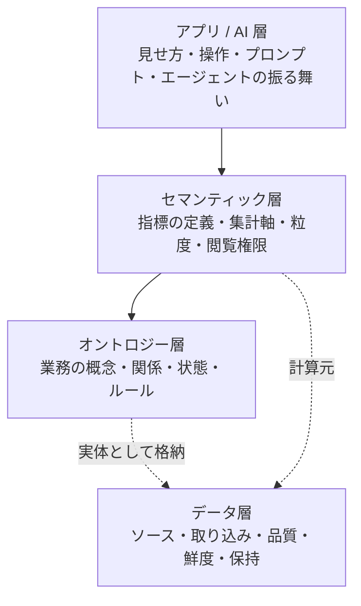

# 01. 4つのレイヤー

> 要件を振り分ける先となる4つのレイヤーと、それぞれが「持つもの」「持たないもの」を定義します。迷ったときは、この表に戻って「このレイヤーの責任か？」を確認してください。

## 全体像

上の層は下の層を「使う」だけで、下の層の意味を書き換えません。意味やルールは**それを必要とする全員が共有できる、いちばん下の層**に置きます。

## レイヤー定義

| レイヤー | 一言でいうと | 持つもの | 持たないもの | 典型的な実装先 |
|---|---|---|---|---|
| オントロジー層 | 業務の「モノ・関係・ルール」 | エンティティ（顧客・契約・商品）、関係（顧客は複数の契約を持つ）、状態と遷移（契約：申込→有効→解約）、業務ルール（解約は月末締め）、用語の正式な意味 | 数値の計算式、画面表示用のラベル、取り込み元の都合 | 概念モデル、ナレッジグラフ、ドメインモデル、用語集、マスタ定義 |
| セマンティック層 | 数字の「定義」 | 指標（売上・解約率）の計算式、集計軸（ディメンション）、粒度、期間の定義（会計月か暦月か）、行・列レベルの閲覧権限 | 業務概念そのものの定義、画面のレイアウト | メトリクスレイヤー、dbt semantic models、BI のデータモデル、指標カタログ |
| データ層 | データの「出どころと品質」 | ソースシステム、取り込み方式と頻度、データ品質ルール（欠損・重複・整合性）、履歴の持ち方、保持期間、リネージ | 指標の意味、業務ルールの判断 | DWH / データレイク、ETL・ELT、データ品質チェック、データカタログ |
| アプリ / AI 層 | 「誰に・どう見せ・どう動かすか」 | 画面・帳票・通知、操作フロー、AI のプロンプトとツール、エージェントの権限範囲、UX 上の初期値や並び順 | 業務ルール、指標の定義（ここに書くと他の利用者と食い違う） | Web アプリ、BI ダッシュボード、チャット UI、AI エージェント |

## なぜ AI 活用でこの区別が重要になるのか

- **AI は書かれたものをそのまま信じる。** 「解約率」の定義がダッシュボードとプロンプトにそれぞれ書かれていると、人間は文脈で補正できても AI は補正できず、答えが割れます。
- **実装コストが下がるほど、置き場所の誤りが増殖する。** アプリを速く作れるようになると、同じルールのコピーが画面・プロンプト・バッチに散らばりやすくなります。
- **下の層は AI にとっての共通言語になる。** オントロジーとセマンティック層が整っていれば、新しいエージェントやダッシュボードを作るたびに定義をやり直す必要がありません。

## 層の境目を判定する3つのテスト

| テスト | Yes なら | No なら | 例 |
|---|---|---|---|
| T1：**1件**の対象について答えられるか | オントロジー層 | T2へ | 「この会員はアクティブか」→ オントロジー層 |
| T2：**集合**に対する計算・集計・閲覧範囲の話か | セマンティック層 | T3へ | 「アクティブ率＝アクティブ会員 ÷ 在籍会員」→ セマンティック層 |
| T3：システムを入れ替えたら**変わる**か | データ層 | アプリ / AI 層を疑う | 「入館記録は入館システムの checkin テーブル」→ データ層 |

T1 によって、**1件ずつ判定できる区分はオントロジー、その区分を数えた結果はセマンティック**と分かれます。セマンティック層は新しい概念を作らず、オントロジーの概念を数えるだけの層になります。

## 層と層の間の契約

層を分けても、つなぎ目が決まっていないと AI は迷います。各層の間で次の参照を必須にします。

| つなぎ目 | 必須の参照 | 守れていないときの症状 |
|---|---|---|
| セマンティック → オントロジー | すべての指標は、数える対象の概念 ID と、使う状態・ルールの ID を持つ | 指標の中に独自の条件が埋まり、概念と二重定義になる |
| データ → オントロジー | すべてのエンティティに、ソースのどの ID で一意になるか（名寄せのキー）を対応づける | 同じ会員が2人として数えられる |
| データ → セマンティック | すべての指標に、計算元のテーブル・列と鮮度（いつ時点まで）を対応づける | AI が古いデータで「今月」の数字を答える |

オントロジー層の中をさらにどう分解するかは、[06 オントロジー設計ガイド](06_ontology-design.md) を参照してください。

## 境界でよく迷うケース

| ケース | 置く層 | 理由 |
|---|---|---|
| 「有効な顧客」とは何か | オントロジー層 | 状態の定義であり、全部署で同じ意味であるべき |
| 「アクティブ率」の分母に休眠顧客を含めるか | セマンティック層 | 指標の計算式の話 |
| 契約データが前日分までしか反映されない | データ層 | 鮮度の話。指標の定義は変わらない |
| ダッシュボードで解約率を赤字表示する閾値 | アプリ / AI 層 | 見せ方の話。ただし閾値が業務上の基準（例：経営会議の警戒ライン）ならセマンティック層へ |
| AI が回答で使ってよい顧客情報の範囲 | セマンティック層（権限）＋アプリ / AI 層（ツール設定） | 「誰が何を見てよいか」は下で決め、エージェントはそれを継承する |
