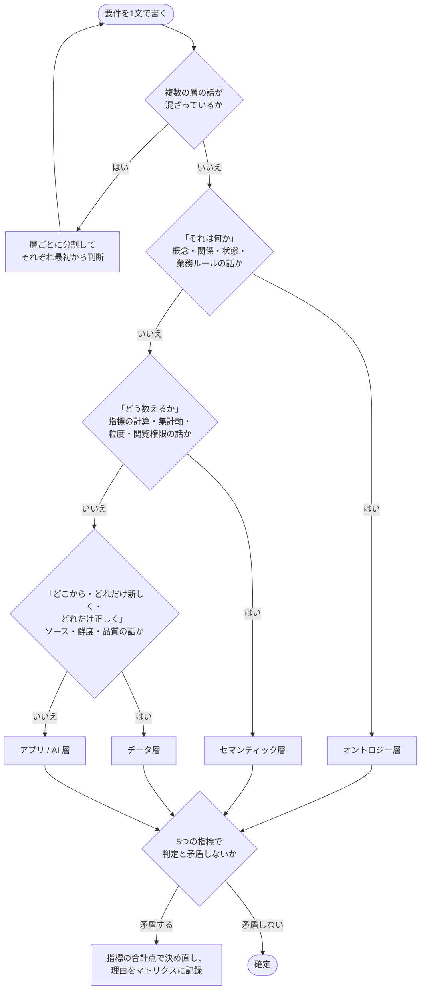

# 02. 振り分けの判断基準

> 要件1件ごとに、まず「判断フロー」で候補の層を出し、迷ったら「5つの指標」で点数をつけて決めます。1つの要件が複数の層にまたがるときは、層ごとに分割してから振り分けます。

## 基本原則

1. **意味は、それを共有する全員が届くいちばん下の層に置く。** 上の層は下の層を参照するだけにする。
2. **1つのルールは1か所にだけ書く。** 同じ定義が2つの層に現れたら、どちらかが誤り。
3. **上の層ほど速く変えられるようにする。** 変更が多いものを下に置くと、変更のたびに全体へ波及する。
4. **AI に解釈させたいものは、プロンプトではなく定義として持つ。** プロンプトには「どの定義を参照するか」だけを書く。

## 判断フロー

## 5つの指標

判断フローは「その要件がどんな**種類**の話か」で層を決めます。5つの指標は、それとは別に「その要件を**共有の定義として下に置くべきか、個別のアプリに留めてよいか**」を判定します。実務でいちばん揉めるのはここです（例：アラートの閾値は画面の設定か、全社の基準か）。

各指標を1〜3点で評価します。データ層は「意味」ではなく「供給」の話なので、Q3 に当てはまるものを置き、点数では判定しません。

| 指標 | 問い | 1点（上の層向き） | 2点 | 3点（下の層向き） |
|---|---|---|---|---|
| 再利用範囲 | この定義を使うのは誰か | 1つの画面・1つのエージェント | 1つの部署・複数の画面 | 部署をまたぐ・全社 |
| ブレたときの影響 | 定義が人によって違ったら何が起きるか | 見た目が少し違う | 誤った判断・手戻り | 金額・契約・法令・対外報告の誤り |
| 変更頻度 | どれくらいの頻度で変わるか | 週〜月単位 | 四半期〜半年 | 年単位、または制度変更時のみ |
| 決定権者 | 誰が決めてよいか | プロダクトチーム・利用者 | 部門長・データ / 分析チーム | 経営・業務オーナー・法務 |
| AI からの参照 | AI が解釈して使うか | 特定の1エージェントだけ | 複数のエージェントや BI | 全社の AI・システムが前提にする |

### 合計点の目安

| 合計（5〜15点） | 判定 | 置く層 |
|---|---|---|
| 9〜15 | 共有の定義にする | 種類に応じてオントロジー層（それは何か）またはセマンティック層（どう数えるか） |
| 5〜8 | 個別に持ってよい | アプリ / AI 層 |

フローの結果と点数が食い違ったときは、次のように扱います。

| フローの結果 | 点数 | 扱い |
|---|---|---|
| アプリ / AI 層 | 9点以上 | 下に下ろす。例：アラートの閾値が経営会議の基準でもあるなら、セマンティック層の指標の一部として定義する |
| オントロジー層・セマンティック層 | 8点以下 | アプリ / AI 層に留めてよい。例：1つの画面だけで使う一時的なキャンペーン区分 |

> 点数は議論を揃えるための道具です。8〜9点付近の要件は、点数よりも「ブレたときの影響」を優先して決め、理由をマトリクスに残してください。

## よくある置き間違い

| 置き間違い | 症状 | 正しい置き場所 |
|---|---|---|
| 業務ルールをプロンプトに書く | エージェントごとに回答が違う。ルール変更時にプロンプトを全部探すことになる | オントロジー層に定義し、プロンプトからは参照する |
| 指標をダッシュボードの計算式で定義する | 同じ「売上」が画面ごとに違う | セマンティック層 |
| データ品質の問題をアプリで補正する | 画面では正しいが、別の利用者や AI には汚れたデータが届く | データ層で品質ルールとして直す |
| 表示用ラベルや並び順をオントロジーに入れる | 画面の都合で概念モデルが頻繁に変わる | アプリ / AI 層 |
| 閲覧権限をアプリごとに実装する | AI エージェント経由だと見えてはいけないデータが見える | セマンティック層（行・列レベル権限） |

## 決めたら記録すること

判断結果は [04 振り分けマトリクス](04_placement-matrix.md) に、点数と理由を添えて記録します。後から「なぜこの層なのか」を説明できることが、この型でいちばん大事な成果物です。
