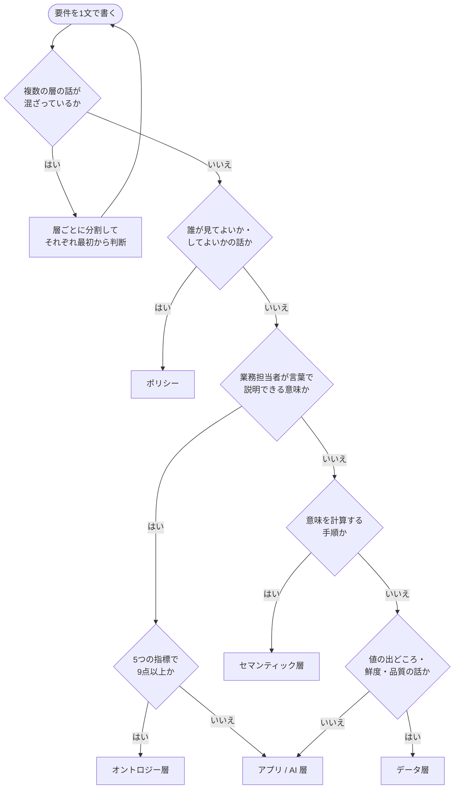

# 02. 振り分けの判断基準

> 要件1件ごとに、まず「判断フロー」で候補の層を出し、迷ったら「5つの指標」で点数をつけて決めます。1つの要件が複数の層にまたがるときは、層ごとに分割してから振り分けます。

## 基本原則

1. **意味はオントロジーに1か所だけ書く。** 画面・プロンプト・ビューは、オントロジーの意味を参照するだけにする。
2. **計算はセマンティック層に1か所だけ実装し、オントロジーからバインドする。** 同じ指標の式が2か所に現れたら、どちらかが誤り。
3. **上の層ほど速く変えられるようにする。** アプリ / AI 層は頻繁に変えてよい。オントロジーを変えるときは影響範囲を確認する。
4. **AI に解釈させたいものは、プロンプトではなく定義として持つ。** プロンプトには「どのオブジェクト・ロジックを使うか」だけを書く。
5. **権限はポリシーとして1か所で定義し、全層で適用する。** プロンプトでのお願いは権限の代わりにならない。

## 判断フロー

セマンティック層に置く要件には、必ず対応するオントロジーのロジックがあります。計算の手順だけが出てきて意味が決まっていない場合は、先にオントロジー側の要件を作ります。

## 5つの指標

判断フローは「その要件がどんな**種類**の話か」で層を決めます。5つの指標は、意味にかかわる要件を「**共有の定義としてオントロジーに置くか、個別のアプリに留めてよいか**」を判定します。実務でいちばん揉めるのはここです（例：アラートの閾値は画面の設定か、全社の基準か）。

各指標を1〜3点で評価します。

| 指標 | 問い | 1点（アプリ向き） | 2点 | 3点（オントロジー向き） |
|---|---|---|---|---|
| 再利用範囲 | この定義を使うのは誰か | 1つの画面・1つのエージェント | 1つの部署・複数の画面 | 部署をまたぐ・全社 |
| ブレたときの影響 | 定義が人によって違ったら何が起きるか | 見た目が少し違う | 誤った判断・手戻り | 金額・契約・法令・対外報告の誤り |
| 変更頻度 | どれくらいの頻度で変わるか | 週〜月単位 | 四半期〜半年 | 年単位、または制度変更時のみ |
| 決定権者 | 誰が決めてよいか | プロダクトチーム・利用者 | 部門長・データ / 分析チーム | 経営・業務オーナー・法務 |
| AI からの参照 | AI が解釈して使うか | 特定の1エージェントだけ | 複数のエージェントや BI | 全社の AI・システムが前提にする |

### 合計点の目安

| 合計（5〜15点） | 判定 | 置く層 |
|---|---|---|
| 9〜15 | 共有の定義にする | オントロジー層（計算が必要ならセマンティック層の実装も作る） |
| 5〜8 | 個別に持ってよい | アプリ / AI 層 |

> **点数は目安です。** 再利用範囲・決定権者・AI からの参照は一緒に高くなりやすく、同じことを重ねて数えがちです。9点という線も経験則なので、機械的に決めるのではなく、判断の理由を揃えるための道具として使います。8〜9点付近の要件は「ブレたときの影響」を優先して決め、理由をマトリクスに残してください。

フローの判定と点数が食い違ったときは、次のように扱います。

| フローの結果 | 点数 | 扱い |
|---|---|---|
| アプリ / AI 層 | 9点以上 | オントロジーに下ろす。例：アラートの閾値が経営会議の基準でもあるなら、判定ロジックとして定義する |
| オントロジー層 | 8点以下 | アプリ / AI 層に留めてよい。例：1つの画面だけで使う一時的なキャンペーン区分 |

## よくある置き間違い

| 置き間違い | 症状 | 正しい置き場所 |
|---|---|---|
| 業務ルールをプロンプトに書く | エージェントごとに回答が違う。ルール変更時にプロンプトを全部探すことになる | オントロジーのロジックとして定義し、プロンプトからは参照する |
| 指標をダッシュボードの計算式で定義する | 同じ「売上」が画面ごとに違う | 意味はオントロジー、式はセマンティック層 |
| 計算方法をロジックの説明文だけに書き、実装を持たない | AI が説明文から毎回式を組み立て、数字がブレる | セマンティック層にビューを実装し、ロジックからバインドする |
| データ品質の問題をアプリで補正する | 画面では正しいが、別の利用者や AI には汚れたデータが届く | データ層で品質ルールとして直す |
| 表示用ラベルや並び順をオントロジーに入れる | 画面の都合で概念モデルが頻繁に変わる | アプリ / AI 層 |
| 閲覧権限をアプリごとに実装する | AI エージェント経由だと見えてはいけないデータが見える | ポリシー（全層で適用） |

## 決めたら記録すること

判断結果は [04 振り分けマトリクス](04_placement-matrix.md) に、点数と理由を添えて記録します。後から「なぜこの層なのか」を説明できることが、この型でいちばん大事な成果物です。
