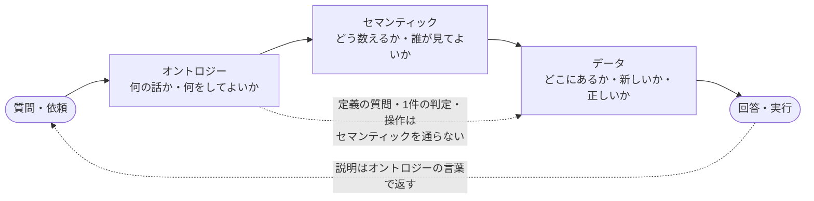
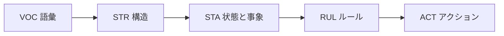

# 06. オントロジー設計ガイド

> オントロジー層は4つの層の中でいちばん中身が広く、AI が最初に読む層です。このガイドでは、オントロジーを「中身の5要素」と「適用範囲の3段」に分解し、AI が参照する順番と、各要素に必須の項目を定めます。層そのものの定義は [01 4つのレイヤー](01_layers.md) を参照してください。

## 1. AI の処理の中でのオントロジー

AI が質問や依頼を処理するときは、オントロジー → セマンティック → データの順に層を下ります。オントロジーの役割は、**質問の言葉を正式な概念に置き換え、対象・時点・制約・許される操作を確定させること**です。

## 2. 中身の5要素

| コード | 要素 | 答える問い | 例（フィットネスチェーン） |
|---|---|---|---|
| VOC | 語彙 | その言葉は、正式にはどの概念を指すか | 「メンバー」「会員さん」→ 会員。「アクティブ」→ アクティブ会員 |
| STR | 構造 | どんなモノがあり、どうつながっているか | 会員 1 — 多 契約、契約 多 — 1 店舗 |
| STA | 状態と事象 | モノはどんな状態を持ち、何が起きると変わるか | 在籍 → 休会 → 在籍。入館、退会申請という事象 |
| RUL | ルール | 常に成り立つ条件、期限、1件ごとの区分 | 退会は月末締め。アクティブ会員の判定条件 |
| ACT | アクション | 誰が何を変更してよいか、その前提と結果 | 休会申請：スタッフが実行、在籍中のみ、在籍 → 休会 |

- **事象を状態と同じ要素に入れる理由**：状態は事象によって変わり、AI が「なぜ変わったか」を説明するときは事象をたどるからです。
- **区分（アクティブ会員など）をルールに入れる理由**：区分は「状態 ＋ 事象 ＋ 条件」から1件ごとに導かれるもので、構造でも状態でもありません。「導出ルール」として持ちます。
- **アクションをオントロジーに入れる理由**：前提条件・結果・AI への許可は業務ルールだからです。どの画面のどのボタンで実行するかはアプリ / AI 層に置きます。

## 3. 適用範囲の3段

| 段 | 範囲 | 決定権 | 変更の重さ |
|---|---|---|---|
| コア | 全社で同じ意味 | 経営・業務オーナー | 重い。全社合意と影響調査が必要 |
| ドメイン | 特定の業務・部署だけ | 部門長 | 中。部門内で決めてよいが、コアと矛盾させない |
| アプリ固有 | 1つのシステムだけ | プロダクトチーム | 軽い。[5つの指標](02_decision-criteria.md) で8点以下ならアプリ / AI 層に出す |

**ドメインはコアを拡張してよいが、上書きしてはいけません。** 経理ドメインで「売上計上日」を足すのはよいが、「会員」の意味を変えるのは不可です。部署が同じ言葉を別の意味で使っている場合は、別の概念（別 ID）として定義し、VOC の「部署ごとの意味の違い」で対応づけます。

2つの軸を合わせると、次のような全体像になります。

|  | VOC 語彙 | STR 構造 | STA 状態と事象 | RUL ルール | ACT アクション |
|---|---|---|---|---|---|
| コア | 会員、契約、店舗 | 会員—契約—店舗 | 会員状態、入館、退会申請 | 退会月末締め、アクティブ会員 | 退会処理、休会申請 |
| ドメイン（経理） | 計上、休会費 | 契約—請求 | 請求状態、入金 | 日割り計算 | 返金処理 |
| ドメイン（店舗運営） | 来館、声かけ | 会員—担当スタッフ | 声かけ実施 | 声かけ対象の条件 | 声かけ記録 |

## 4. 参照順

### 4.1 基本の順番

後ろの要素は、前の要素の言葉だけで書けます。ルールは「どのモノの、どの状態で、どの事象があったら」で書け、アクションは「どのルールを満たすとき、どの状態からどの状態へ」で書けます。**逆向きの参照（構造がルールに依存するなど）は禁止**にすると、AI が循環せずに読めます。

この順番は、そのまま**ヒアリングで聞く順番**と**作る順番**にもなります。言葉が揃わないうちにルールを議論すると、同じ言葉で違うものを話す状態になるからです。

### 4.2 各段階で AI が確定させること

| 順 | 要素 | AI が確定させること | 確定できないときの振る舞い |
|---|---|---|---|
| 1 | VOC | 質問の言葉が指す概念 ID | 候補が複数あれば聞き返す |
| 2 | STR | 対象のモノと、たどる関係 | 関係が定義されていなければ、推測でつながず「定義なし」と返す |
| 3 | STA | どの状態を対象にするか、**いつ時点**の状態か | 既定の時点を使い、回答に明記する |
| 4 | RUL | 当てはまる制約・期限・区分と例外 | コアとドメインが衝突したらコアを優先し、衝突を報告する |
| 5 | ACT | 操作が許されるか、前提を満たすか、AI が実行してよいか | 許可がなければ実行せず、誰に頼めばよいかを返す |

### 4.3 質問の種類と、止まる場所

AI は毎回5要素すべてを読む必要はありません。

| 質問の種類 | 例 | 読む範囲 | その後 |
|---|---|---|---|
| 定義を聞く | 「アクティブ会員って何？」 | VOC → STR（→ RUL） | そのまま回答する |
| 1件の状態を聞く | 「山田さんは今月退会できる？」 | VOC → RUL | データ層で1件を取得する。セマンティック層は通らない |
| 数字を聞く | 「渋谷店の先月の退会率は？」 | VOC → RUL | セマンティック層 → データ層 |
| 理由を聞く | 「なぜ退会率が上がった？」 | VOC → RUL、事象を重点的に | セマンティック層で分解 → データ層 → 事象の言葉で説明する |
| 操作を頼む | 「この会員を休会にして」 | VOC → ACT | データ層へ書き込む。人の確認を挟むかは ACT が決める |

**1件の判定はセマンティック層を通しません。** セマンティック層は集合を計算する層なので、1件の判定はオントロジーのルールで直接行います。ここを指標で代用すると、「集計では退会扱い、個別画面では在籍扱い」のようなズレが起きます。

## 5. 必須項目

### 5.1 全要素に共通

| 項目 | 必須 | 理由 |
|---|---|---|
| ID | ◎ | 他の層・他の要素から参照するため |
| 正式名 | ◎ | |
| 定義文（1〜2文） | ◎ | AI は構造化された項目より先に、文章で意味をつかむ |
| 要素（VOC / STR / STA / RUL / ACT） | ◎ | 参照順を守るため |
| 適用範囲（コア / ドメイン名 / アプリ） | ◎ | 衝突時の優先順位と決定権を決めるため |
| 決定権者 | ◎ | 不明なら「未決」として残す |
| ステータス（案 / 承認済 / 廃止） | ◎ | AI は承認済だけを使い、案は「未確定」と添えて使う |
| 有効期間（開始日・終了日） | ◎ | ルールが変わった前後で、過去の数字の解釈が変わるため |
| 反例（これは含まない） | ○ AI 向けには強く推奨 | 否定形の定義が、AI の誤解をいちばん減らす |
| 根拠（ヒアリング No・規程名） | ○ | なぜその定義なのかを説明できるように |

### 5.2 要素ごと

| 要素 | 必須項目 | あると良い項目 |
|---|---|---|
| VOC 語彙 | 対応する概念 ID、同義語・言い換え | 部署ごとの意味の違い、使ってはいけない意味、英語名 |
| STR 構造（エンティティ） | 一意になる条件（何をもって1件と数えるか）、主な属性 | ソースごとの ID の対応（データ層への参照） |
| STR 構造（関係） | 両端のエンティティ、多重度、必須か任意か | 時間で変わるか（履歴を持つか） |
| STA 状態 | 状態の一覧、初期・終端状態、許される遷移、**時点の定義** | 遷移ごとの所要期間の目安 |
| STA 事象 | 記録される条件、発生日時の定義、引き起こす状態遷移 | 取り消しの扱い |
| RUL ルール | 種類（制約 / 期限 / 導出区分）、対象、条件、例外、違反時の扱い（エラー / 警告 / 人が判断） | 違反を検知するデータ品質ルールへの参照 |
| ACT アクション | 実行者（役割）、前提条件（STA・RUL の ID）、結果（状態遷移）、**AI への許可**（自動 / 人の確認後 / 禁止） | 取り消し可否、承認者、通知先 |

### 5.3 AI 向けに特に効く4項目

| 項目 | なぜ効くか |
|---|---|
| 定義文 | ID や列挙値だけだと、何のための区分かを AI が取り違える |
| 反例 | AI は境界を広めに解釈しがち。含まないものを書くと境界が締まる |
| 時点の定義 | 「今月の会員数」が月初時点か現在時点かで答えが変わる。書かれていないと AI は毎回違う解釈をする |
| AI への許可 | プロンプトに「勝手に処理しないで」と書く代わりに定義として持てる。エージェントを増やしても同じ制約が効く |

## 6. よくある迷い

| 迷い | 扱い |
|---|---|
| 区分はルールか、セマンティック層の指標か | 1件ごとに判定できるならルール（RUL）。判定に集合の情報が必要な区分（「上位10%の優良会員」）はセマンティック層で定義し、オントロジーからは参照だけにする |
| 部署ごとに言葉の意味が違い、統一できない | 上書きはせず、別の概念として定義する。VOC で対応づけ、AI に言い換えさせる |
| 承認ワークフローの細かい手順はどこに置くか | 誰の承認が必要か（前提条件）は ACT。承認画面の流れや通知の文面はアプリ / AI 層 |
| 過去の数字を当時の定義で出すか、今の定義で出すか | オントロジーは有効期間を持つだけにし、どちらで出すかはセマンティック層で指標ごとに決める |
