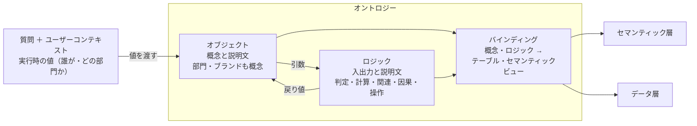

# 06. オントロジー設計ガイド

> オントロジー層は、AI がアプリ / AI 層から受け取った質問の「意味」を確定する層です。このガイドでは、オントロジーを **オブジェクト・ロジック・バインディング** の3つに分け、それぞれの設計ルールと必須項目を定めます。層そのものの定義は [01 4つのレイヤーと横断ポリシー](01_layers.md) を参照してください。

## 1. 構造

| 要素 | 役割 | 例（フィットネスチェーン） |
|---|---|---|
| オブジェクト | 業務の概念。名詞で、説明文を持つ。属性・状態・関係を持つ | 会員、契約、店舗、部門、入館 |
| ロジック | オブジェクトを入力し、オブジェクトを出力する処理。動詞で、説明文を持つ | アクティブか判定する（会員, 時点）→ 真偽、退会率を算出する（店舗, 期間）→ 指標 |
| バインディング | オブジェクトやロジックが、どのテーブル・ビューで保存・計算されているか | 会員 → 会員マスタ、退会率を算出する → 週次退会率ビュー |

ロジックが不要な概念（「店舗の所在地は？」など）は、オブジェクトから直接バインディングへ進みます。

## 2. 設計ルール

| No | ルール | 理由 |
|---|---|---|
| 1 | 最小単位は「概念」。単語は概念のラベルとして扱う | 同じ概念を部署ごとに違う言葉で呼んでも、1つの概念にまとめられる |
| 2 | ユーザーコンテキストは、部門などの概念に実行時の値を渡す入力にする | 「誰が聞いているか」を、プロンプトの文章ではなく値として扱える |
| 3 | ロジックの入力・出力はすべてオブジェクトにする。ロジック同士はオブジェクトを経由してつながる | 入出力の型がそろうので、AI がロジックを組み合わせて推論できる |
| 4 | 同じ出力のロジックが部門ごとに複数あるときは、部門を引数に含めて区別する。部門を指定しない**既定版を必ず1つ**持つ | 部門ごとの違いを1つのオントロジーで扱いつつ、全社共通の定義を見失わない |
| 5 | バインディングはオブジェクトと、計算・判定のロジックから張る | 意味（オントロジー）と実装（セマンティック・データ）をつなぐ |
| 6 | 命名：ロジックは動詞、オブジェクトは名詞 | 読むだけで「モノ」か「処理」かが分かる |
| 7 | 計算などの処理内容は、ロジックの説明文に**意味として**書く。実際の計算はバインド先のセマンティックビューで行う | 説明文は人と AI が読む意味、ビューは数字を出す実装。AI が説明文から式を組み立てると数字がブレる |
| 8 | 状態を変えるロジック（操作）は、前提条件と結果を説明文に書く。実行してよい人・AI はポリシーで決める | 何が起きるかは意味、誰がしてよいかは権限 |
| 9 | アクセス制御はオントロジーの外（ポリシー）で扱う | 権限を全層で一貫して効かせる |

## 3. ロジックの種類

| 種類 | 出力 | 例 | 主なバインド先 |
|---|---|---|---|
| 判定 | 真偽・区分 | アクティブか判定する（会員, 時点）→ 真偽 | セマンティックビュー |
| 計算 | 指標 | 退会率を算出する（店舗, 期間）→ 指標 | セマンティックビュー |
| 関連 | 関係するオブジェクト | 契約を取得する（会員）→ 契約 | テーブル |
| 因果 | 要因となるオブジェクト | 退会要因を挙げる（店舗, 期間）→ 会員区分 | セマンティックビュー（要因の候補は事前に定義） |
| 操作 | 変更後のオブジェクト | 休会を申請する（会員, 開始月）→ 会員（休会） | テーブルへの書き込み |

業務ルール（「退会は月末締め」など）は、判定または計算のロジックとして書きます（例：退会確定日を決める（会員, 申請日）→ 日付）。状態とその遷移は、オブジェクトの属性として「取りうる値」と「許される遷移」を持ちます。

## 4. 参照順と、足りないものが見つかったとき

AI は オブジェクト → ロジック → バインディング の順に読みます。言葉からオブジェクトを確定し、必要なロジックを選び、バインド先で計算・取得します。

この順番は、ヒアリングで聞く順番と作る順番にもなります。ただし**1回で上から下まで完成させる必要はありません。** ロジックを書いていて「入館」というオブジェクトが足りないと分かったら、オブジェクトに戻って足し、ロジックからはそれを参照します。禁止しているのは、ロジックの中で「入館とは〜」と概念をこっそり定義することです。そうすると定義が2か所に散ります。

「前の要素の言葉だけで書く」という縛りがあるので、書けない＝前の要素に穴がある、とすぐ分かります。実際の進め方は、全体をざっくり通す → 書けないところを前に戻って足す、を何周も回す形になります。

## 5. 質問の種類と、オントロジーで読む範囲

| 質問の種類 | 例 | 読む要素 | その後 |
|---|---|---|---|
| 定義を聞く | 「アクティブ会員って何？」 | オブジェクト、ロジックの説明文 | そのまま回答する |
| 1件の属性を聞く | 「山田さんの所属店舗は？」 | オブジェクト → バインディング | データ層から取得する |
| 1件を判定する | 「山田さんはアクティブ？」 | オブジェクト → 判定ロジック → バインディング | セマンティックビューで判定する |
| 数字を聞く | 「渋谷店の先月の退会率は？」 | オブジェクト → 計算ロジック → バインディング | セマンティックビューで計算する |
| 理由を聞く | 「なぜ退会率が上がった？」 | 計算ロジック ＋ 因果ロジック | 切り口ごとに分解し、要因のオブジェクトの言葉で説明する |
| 操作を頼む | 「この会員を休会にして」 | オブジェクト → 操作ロジック | ポリシーで AI の実行可否を確認し、データ層に書き込む |

## 6. 必須項目

### 6.1 オブジェクト

| 項目 | 必須 | 理由 |
|---|---|---|
| ID・正式名（名詞） | ◎ | |
| ラベル（同義語・部署ごとの呼び方） | ◎ | 言葉から概念にたどり着くための索引 |
| 説明文（1〜2文） | ◎ | AI は構造化された項目より先に、文章で意味をつかむ |
| 反例（これは含まない） | ○ AI 向けには強く推奨 | 否定形の定義が、AI の誤解をいちばん減らす |
| 一意になる条件 | ◎ | 何をもって1件と数えるか |
| 主な属性・関係 | ◎ | 関係は相手のオブジェクトと多重度（1対多など） |
| 状態（取りうる値・許される遷移・**時点の定義**） | 状態を持つなら ◎ | 「今月の会員数」が月初時点か現在時点かで答えが変わる |
| バインディング | ○ | 保存先のテーブルと名寄せのキー |
| 決定権者・ステータス（案 / 承認済 / 廃止）・有効期間 | ◎ | AI は承認済だけを使い、案は「未確定」と添えて使う |

### 6.2 ロジック

| 項目 | 必須 | 理由 |
|---|---|---|
| ID・名前（動詞） | ◎ | |
| 種類（判定 / 計算 / 関連 / 因果 / 操作） | ◎ | |
| 入力（オブジェクト）・出力（オブジェクト） | ◎ | ロジック同士をつなぐため |
| 説明文（意味として何をするか） | ◎ | 計算の場合も、式ではなく意味を書く |
| 時点の扱い | 時間に依存するなら ◎ | 「いつ時点で判定するか」を引数か既定値で決める |
| 部門別の版と既定版 | 部門で違うなら ◎ | ルール4 |
| バインディング（実装するビュー） | 判定・計算なら ◎ | ルール7 |
| 前提条件・結果 | 操作なら ◎ | ルール8。実行してよい人・AI はポリシーに書く |
| 決定権者・ステータス・有効期間 | ◎ | ルールが変わった前後で、過去の数字の解釈が変わるため |

### 6.3 AI 向けに特に効く4項目

| 項目 | なぜ効くか |
|---|---|
| 説明文 | ID や列挙値だけだと、何のための概念・処理かを AI が取り違える |
| 反例 | AI は境界を広めに解釈しがち。含まないものを書くと境界が締まる |
| 時点の定義 | 書かれていないと、AI は毎回違う時点で解釈する |
| バインディング | あれば AI は式を組み立てずにビューを呼ぶだけで済み、数字が毎回同じになる |

## 7. よくある迷い

| 迷い | 扱い |
|---|---|
| 部署ごとに言葉の意味が違い、統一できない | 同じ概念なら、ラベルで呼び方の違いを吸収する。意味が違うなら別のオブジェクトにするか、部門を引数にしたロジックで区別する |
| オントロジーが大きくなりすぎる | AI にはラベルを索引にして関係する部分だけを渡す。全部をプロンプトに入れない |
| 計算方法が説明文とビューで食い違う | ビューは説明文を実装したもの、という前提でレビューする。説明文を直すときはビューも同時に直す |
| 過去の数字を当時の定義で出すか、今の定義で出すか | ロジックに有効期間を持たせ、どちらで出すかを説明文に書く |
| BI ツールがセマンティックビューを直接使う | オントロジーを通らない入口になり、意味がずれる余地が残る。ビューの説明はオントロジーのロジックへのリンクにして、定義を二重に書かない |
