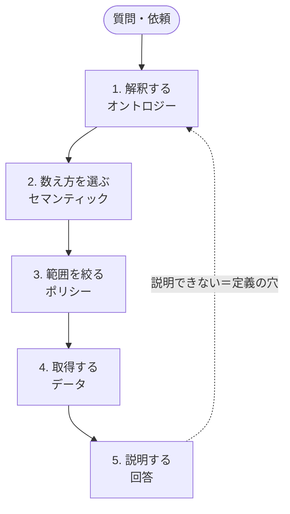
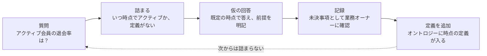

# 07. AI が質問を処理する流れ

> AI は質問を受け取ると、意味 → 数え方 → 権限 → 値 の順に具体化して答えます。このガイドでは、各段階で読む層、質問の種類ごとの経路、各段階で AI が守ること、定義の穴を埋める戻り道を定めます。図つきの HTML 版は [docs/ai-processing-flow.html](../../docs/ai-processing-flow.html) にあります。

## 1. 全体の流れ

| 段階 | 層 | AI がやること | 出力の例（「渋谷店の先月のアクティブ会員の退会率は？」） |
|---|---|---|---|
| 1. 解釈する | オントロジー | 言葉を正式な概念に置き換え、質問の種類と時点を決める | 概念 ID（アクティブ会員・退会・店舗）、種類＝数字、時点＝先月末 |
| 2. 数え方を選ぶ | セマンティック | 定義済みの指標と切り口から選ぶ | 指標＝退会率、切り口＝店舗、期間＝先月 |
| 3. 範囲を絞る | ポリシー | 質問した人の権限を、AI がそのまま引き継ぐ | 店舗長なので渋谷店のみ取得可 |
| 4. 取得する | データ | 値と一緒に、鮮度と品質の情報も受け取る | 退会率 3.1%、先月分は確定済み、品質エラー 0 件 |
| 5. 説明する | 回答 | オントロジーの言葉で説明し、データの注意点を添える | 「先月末に確定した退会を、月初の在籍会員（休会を除く）で割ると 3.1% です」 |

## 2. 質問の種類と経路

AI は毎回すべての層を通るわけではありません。1件の判定や操作は集合を計算しないので、セマンティック層を通りません。ポリシーは、値に触れるすべての経路で通ります。

| 質問の種類 | 例 | 1. 解釈 | 2. 数え方 | 3. 範囲 | 4. 取得 | 5. 説明 |
|---|---|:-:|:-:|:-:|:-:|:-:|
| 定義を聞く | アクティブ会員って何？ | ● | — | — | — | ● |
| 1件を聞く | 山田さんは今月退会できる？ | ● | — | ● | ● | ● |
| 数字を聞く | 先月の退会率は？ | ● | ● | ● | ● | ● |
| 理由を聞く | なぜ退会率が上がった？ | ● | ● | ● | ● | ● |
| 操作を頼む | この会員を休会にして | ● | — | ● | ● | ● |

- **理由を聞く**：数字を切り口ごとに分解したうえで、オントロジーの事象（入館の減少、退会申請など）の言葉で説明します。
- **操作を頼む**：オントロジーのアクション定義で、AI に許可されているか（自動 / 人の確認後 / 禁止）を確かめてから書き込みます。

## 3. 各段階で AI が守ること

| 段階 | してよいこと | してはいけないこと | 理由 |
|---|---|---|---|
| 1. 解釈 | 語彙を索引にして、関係する部分だけ取り出す | オントロジー全体をプロンプトに入れる。意味を推測で補う | オントロジーは大きくなるため、全部読ませると精度が落ちる。候補が複数あれば聞き返す |
| 2. 数え方 | 定義済みの指標と切り口から選ぶ | SQL や計算式をその場で書く | AI が式を書くと、同じ質問でも毎回違う数字になり得る。定義にない質問には「未定義」と答え、新しい指標の案を出す |
| 3. 範囲 | 取得の時点で権限を強制する | 「見せないで」とプロンプトでお願いする | プロンプトの指示は破られることがある。見てはいけない値は、そもそも AI に渡さない |
| 4. 取得 | 値と、いつ時点か・欠損や品質エラーをセットで受け取る | 値だけを受け取って答える | 鮮度を知らない AI は、古い数字を自信を持って答えてしまう |
| 5. 説明 | オントロジーの言葉で説明し、使った定義と注意点を示す | 定義に出てこない言葉で、もっともらしく説明する | 説明できないときは、無理に答えず「定義の穴」として記録する |

## 4. 戻り道：回答がオントロジーを鍛える

AI が説明に詰まった箇所は、そのまま要件定義の宿題になります。運用するほど定義が埋まっていく循環です。

記録した穴は、[04 振り分けマトリクス](04_placement-matrix.md) の未決事項に入れます。
