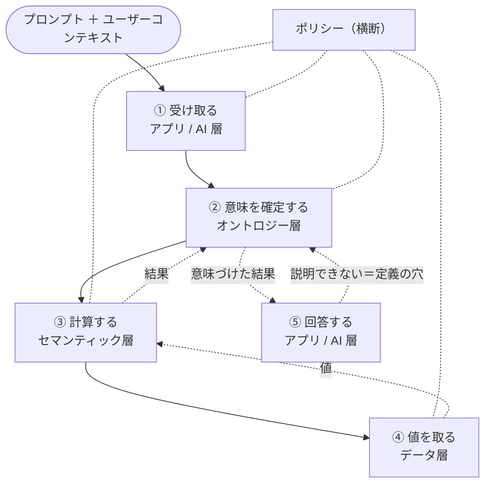
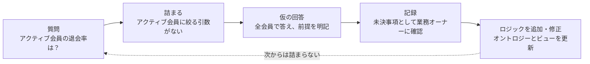

# 07. AI がプロンプトを処理する流れ

> AI はプロンプトを受け取ると、アプリ / AI → オントロジー → セマンティック → データ の順に層を下り、結果を逆向きにたどって回答します。ポリシーは4つの層すべてで効きます。このガイドでは、各段階でやること、質問の種類ごとの経路、各段階で AI が守ること、定義の穴を埋める戻り道を定めます。図つきの HTML 版は [docs/ai-processing-flow.html](../../docs/ai-processing-flow.html) にあります。

## 1. 全体の流れ

| 段階 | 層 | AI がやること | ポリシーが効くこと | 出力の例（「渋谷店の先月の退会率は？」店舗長） |
|---|---|---|---|---|
| ① 受け取る | アプリ / AI | プロンプトとユーザーコンテキスト（誰が・どの部門か）を受け取る | このエージェントを使ってよい人か | 質問者＝店舗長、部門＝渋谷店 |
| ② 意味を確定する | オントロジー | 言葉をオブジェクトに置き換え、使うロジックと引数を決める | 参照・実行してよいオブジェクト・ロジックか | 退会率を算出する（店舗＝渋谷店, 期間＝先月） |
| ③ 計算する | セマンティック | ロジックにバインドされたビューで計算する | ビューのどの行・列を返してよいか | 週次退会率ビューを渋谷店の行だけで計算 |
| ④ 値を取る | データ | 値と一緒に、鮮度と品質の情報を受け取る | 保存・取得の時点での制限、マスキング | 先月分は確定済み、品質エラー 0 件 |
| ⑤ 回答する | アプリ / AI | オントロジーの言葉で説明し、注意点を添えて見せる | 見せてよい形か | 「先月末に確定した退会を、月初の在籍会員（休会を除く）で割ると 3.1% です」 |

## 2. 質問の種類と経路

AI は毎回すべての層を通るわけではありません。計算のない質問はセマンティック層を通らず、定義だけを聞く質問はデータ層まで行きません。ポリシーは、通るすべての層で効きます。

| 質問の種類 | 例 | ① アプリ / AI | ② オントロジー | ③ セマンティック | ④ データ |
|---|---|:-:|:-:|:-:|:-:|
| 定義を聞く | アクティブ会員って何？ | ● | ● | — | — |
| 1件の属性を聞く | 山田さんの所属店舗は？ | ● | ● | — | ● |
| 1件を判定する | 山田さんはアクティブ？ | ● | ● | ● | ● |
| 数字を聞く | 先月の退会率は？ | ● | ● | ● | ● |
| 理由を聞く | なぜ退会率が上がった？ | ● | ● | ● | ● |
| 操作を頼む | この会員を休会にして | ● | ● | — | ● |

- **理由を聞く**：計算ロジックと因果ロジックを組み合わせ、要因のオブジェクト（会員区分など）の言葉で説明します。
- **操作を頼む**：操作ロジックの前提条件を確かめ、ポリシーで AI が実行してよいか（自動 / 人の確認後 / 禁止）を確認してから書き込みます。

## 3. 各段階で AI が守ること

| 段階 | してよいこと | してはいけないこと | 理由 |
|---|---|---|---|
| ① 受け取る | ユーザーコンテキストを値としてオントロジーに渡す | 業務の定義やルールをプロンプトに書く | プロンプトに書いた定義はエージェントごとにずれる |
| ② 意味を確定する | ラベルを索引にして、関係するオブジェクトとロジックだけを取り出し、組み合わせる | オントロジー全体をプロンプトに入れる。意味や式を推測で補う | オントロジーは大きくなるため、全部読ませると精度が落ちる。候補が複数あれば聞き返す |
| ③ 計算する | バインドされたビューを呼び出す | SQL や計算式をその場で書く | AI が式を書くと、同じ質問でも毎回違う数字になり得る。ロジックやビューがない質問には「未定義」と答え、新しいロジックの案を出す |
| ④ 値を取る | 値と、いつ時点か・欠損や品質エラーをセットで受け取る | 値だけを受け取って答える | 鮮度を知らない AI は、古い数字を自信を持って答えてしまう |
| ⑤ 回答する | オントロジーの言葉で説明し、使った定義と注意点を示す | 定義に出てこない言葉で、もっともらしく説明する | 説明できないときは、無理に答えず「定義の穴」として記録する |
| 全段階（ポリシー） | 各層でポリシーを強制する | 「見せないで」とプロンプトでお願いする | プロンプトでの指示は破られることがある。見てはいけない値は、そもそも AI に渡さない |

## 4. 戻り道：回答がオントロジーを鍛える

AI が説明に詰まった箇所は、そのまま要件定義の宿題になります。運用するほど定義が埋まっていく循環です。

記録した穴は、[04 振り分けマトリクス](04_placement-matrix.md) の未決事項に入れます。
