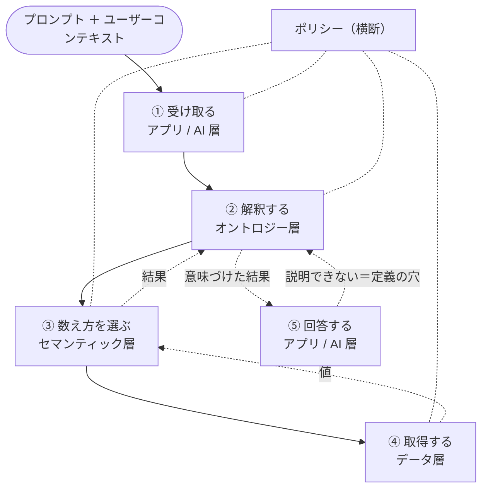
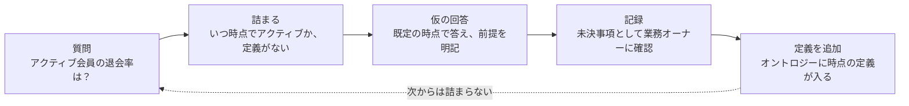

# 07. AI がプロンプトを処理する流れ

> AI はプロンプトを受け取ると、アプリ / AI → オントロジー → セマンティック → データ の順に層を下り、結果を逆向きにたどって回答します。ポリシーは4つの層すべてで効きます。このガイドでは、各段階でやること、質問の種類ごとの経路、各段階で AI が守ること、定義の穴を埋める戻り道を定めます。図つきの HTML 版は [docs/ai-processing-flow.html](../../docs/ai-processing-flow.html) にあります。

## 1. 全体の流れ

| 段階 | 層 | AI がやること | ポリシーが効くこと | 出力の例（「渋谷店の先月の退会率は？」店舗長） |
|---|---|---|---|---|
| ① 受け取る | アプリ / AI | プロンプトとユーザーコンテキスト（誰が・どの部門か）を受け取る | このエージェントを使ってよい人か | 質問者＝店舗長、所属＝渋谷店 |
| ② 解釈する | オントロジー | 言葉を正式な概念に置き換え、質問の種類と時点を決める（語彙 → 構造 → 状態と事象 → ルール → アクション） | 実行してよいアクションか、AI に任せてよいか | 概念 ID（退会・店舗）、種類＝数字、時点＝先月末 |
| ③ 数え方を選ぶ | セマンティック | 定義済みの指標と切り口から選ぶ | 指標をどの範囲で返してよいか | 指標＝退会率、切り口＝店舗、期間＝先月。渋谷店の範囲だけ |
| ④ 取得する | データ | 値と一緒に、鮮度と品質の情報も受け取る | 保存・取得の時点での制限、マスキング | 退会率 3.1%、先月分は確定済み、品質エラー 0 件 |
| ⑤ 回答する | アプリ / AI | オントロジーの言葉で説明し、データの注意点を添えて見せる | 見せてよい形か | 「先月末に確定した退会を、月初の在籍会員（休会を除く）で割ると 3.1% です」 |

## 2. 質問の種類と経路

AI は毎回すべての層を通るわけではありません。1件の判定や操作は集合を数えないので、セマンティック層を通りません。定義だけを聞く質問はデータ層まで行きません。ポリシーは、通るすべての層で効きます。

| 質問の種類 | 例 | ① アプリ / AI | ② オントロジー | ③ セマンティック | ④ データ |
|---|---|:-:|:-:|:-:|:-:|
| 定義を聞く | アクティブ会員って何？ | ● | ● | — | — |
| 1件を聞く | 山田さんは今月退会できる？ | ● | ● | — | ● |
| 数字を聞く | 先月の退会率は？ | ● | ● | ● | ● |
| 理由を聞く | なぜ退会率が上がった？ | ● | ● | ● | ● |
| 操作を頼む | この会員を休会にして | ● | ● | — | ● |

- **理由を聞く**：数字を切り口ごとに分解したうえで、オントロジーの事象（入館の減少、退会申請など）の言葉で説明します。
- **操作を頼む**：オントロジーのアクション定義で前提条件を確かめ、ポリシーで AI が実行してよいか（自動 / 人の確認後 / 禁止）を確認してから書き込みます。

## 3. 各段階で AI が守ること

| 段階 | してよいこと | してはいけないこと | 理由 |
|---|---|---|---|
| ① 受け取る | ユーザーコンテキストを値としてオントロジーに渡す | 業務の定義やルールをプロンプトに書く | プロンプトに書いた定義は、エージェントごとにずれていく |
| ② 解釈する | 語彙を索引にして、関係する部分だけ取り出す | オントロジー全体をプロンプトに入れる。意味を推測で補う | オントロジーは大きくなるため、全部読ませると精度が落ちる。候補が複数あれば聞き返す |
| ③ 数え方を選ぶ | 定義済みの指標と切り口から選ぶ | SQL や計算式をその場で書く | AI が式を書くと、同じ質問でも毎回違う数字になり得る。定義にない質問には「未定義」と答え、新しい指標の案を出す |
| ④ 取得する | 値と、いつ時点か・欠損や品質エラーをセットで受け取る | 値だけを受け取って答える | 鮮度を知らない AI は、古い数字を自信を持って答えてしまう |
| ⑤ 回答する | オントロジーの言葉で説明し、使った定義と注意点を示す | 定義に出てこない言葉で、もっともらしく説明する | 説明できないときは、無理に答えず「定義の穴」として記録する |
| 全段階（ポリシー） | 各層でポリシーを強制する | 「見せないで」とプロンプトでお願いする | プロンプトの指示は破られることがある。見てはいけない値は、そもそも AI に渡さない |

## 4. 戻り道：回答がオントロジーを鍛える

AI が説明に詰まった箇所は、そのまま要件定義の宿題になります。運用するほど定義が埋まっていく循環です。

記録した穴は、[04 振り分けマトリクス](04_placement-matrix.md) の未決事項に入れます。
